# LeoWay - System Specification

Version 0.7 · 22 October 2026 · Draft

**Team:** LRD (Leo Research Department)

**Authors:** Laurenz (LPuehringerStudent), Ayan (Ayan2310), David (David-Fruehwirt), Behrang (BehrangEl11).

## 1. Initial situation and goal

### 1.1 Application domain

HTL Leonding students travel to school using Linz AG bus 19 at Limesstraße, trams 3 and 4 and buses 11, 19 and 191 at Meixnerkreuzung, regional OÖVV buses such as 611 and 618, and ÖBB trains. Lessons start at 07:05 (period 0) or 08:00 (period 1).

The school plans lessons in WebUntis, including cancellations, substitutions and exams. Teachers record late arrivals there as a short absence; the form teacher decides whether it is excused. Linz AG publishes live departures; the other operators publish timetables. LeoWay connects the student's WebUntis data with recorded transport delays.

### 1.2 Terms

| Term | Meaning |
| --- | --- |
| Access key | The student's WebUntis key (Profil → Freigaben), used instead of the password. |
| Form teacher | The class teacher (Klassenvorstand) who decides about excusing lateness. |
| First real lesson | The first lesson that still takes place after cancellations and changes. |
| Exam day | A day with an exam (e.g. a Schularbeit) from WebUntis. Manual marking is a fallback when exam data is missing. |
| Leave-by time | When to leave home to reach the first real lesson, including walking time and a buffer. |
| Lateness entry | A WebUntis absence starting at the first real lesson and ending within it; longer absences are not matched automatically. |
| Delay record | A stored departure with its line, stop, planned time, reported delay, source and collection time. |
| Delay appeal | An email from the student to the form teacher that links a lateness entry to a delay record. |
| Verification link | A link in the appeal showing only the shared delay record. |
| Crowd report | A disruption reported by a student; several reports can trigger a warning. |
| auspex-lang | A small rule language for personal alerts, such as a delay over five minutes on an exam day. |

### 1.3 Business processes today

**BP1 · Getting to school.** The student checks WebUntis for changes and, separately, Scotty or the Linz AG app for departures, and works out the leave-by time in their head. Delays are usually noticed at the stop, too late for an earlier connection.

**BP2 · Excusing lateness.** The teacher in the first lesson records a lateness entry in WebUntis. The student sends a photo of the vehicle display or a Scotty screenshot to the form teacher, who cannot check whether it is genuine or from that morning.

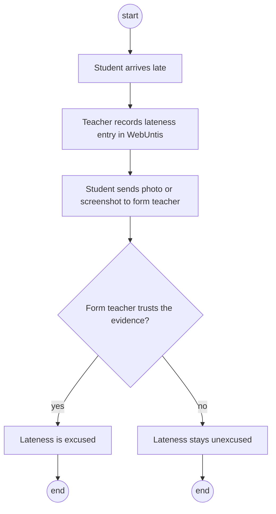

**BP3 · Reporting problem connections.** Nobody collects evidence about connections that are often late, so the student council has nothing to take to Linz AG or OÖVV.

### 1.4 Goal

| Goal | Target |
| --- | --- |
| Timetable-aware alerts | Every alert uses the student's first real lesson, including cancellations, substitutions and exams (BP1). |
| Early delay warnings | A student whose saved journey will arrive late is warned and offered another connection where one exists (BP1). |
| Trustworthy appeals | A late student prepares an appeal in under one minute; the form teacher checks it through the verification link (BP2). |
| Data history | The delay recorder runs continuously from the first sprint, including holidays (BP3). |
| Crowd reports | A disruption confirmed by several students triggers a warning, often before official feeds show it. |
| Prediction (optional) | If we add a model, compare it with "same delay as yesterday" and "average delay of this trip". The main app works without it. |
| School statistics | One report on connections that regularly arrive after lessons start, handed to the student council (BP3). |

**Limits:** LeoWay only reads WebUntis. Students send appeals themselves and teachers still decide; a delay record shows what a source reported, not that the student was on the vehicle. Not included: GPS, home addresses and a native iPhone app (iPhone users use the website). Other schools, indoor navigation and a public delay dataset are later extensions.


<!-- page -->

## 2. Functional requirements

The twelve use cases are grouped into four blocks. Each block starts with an overview diagram. Each use case lists its process, goal, precondition, postcondition, roles and trigger, followed by a normal case, an error case, three small screen sketches and an activity diagram. Screen values are examples, not measured results. These are first sketches, not the final app design.

### 2.1 Block A: Timetable and leave-by time

The student connects WebUntis once and saves a route; LeoWay then calculates the leave-by time every school day.


#### F01 · Connect WebUntis

| Characteristic | Description |
| --- | --- |
| Business process | BP1 Getting to school, BP2 Excusing lateness |
| Goal | LeoWay can read the student's lessons, exams and lateness entries. |
| Precondition | The student has a LeoWay account and a WebUntis access key. |
| Postcondition | The key is stored encrypted; the first sync has loaded the timetable. Absence reasons and notes are never stored. |
| Involved roles | Student; WebUntis (external system) |
| Triggering event | The student taps "Connect WebUntis" during setup or in Route and alerts. |

**Standard scenario.** The student enters username and access key. LeoWay logs in, loads the timetable and shows the next first real lesson.

**Non-standard scenario.** The key is wrong or revoked: LeoWay stores nothing and shows "Access key not accepted" with help. If WebUntis is down, the student retries later.

```screens
Call: Route and alerts
WebUntis      not connected
[Connect WebUntis]
---
Standard: connected
Username      [ max.muster ]
Access key    [ •••••••• ]
Connected · first lesson 08:00
---
Non-standard: key rejected
Access key    [ •••••••• ]
Error: access key not accepted
[How to create a key]
```

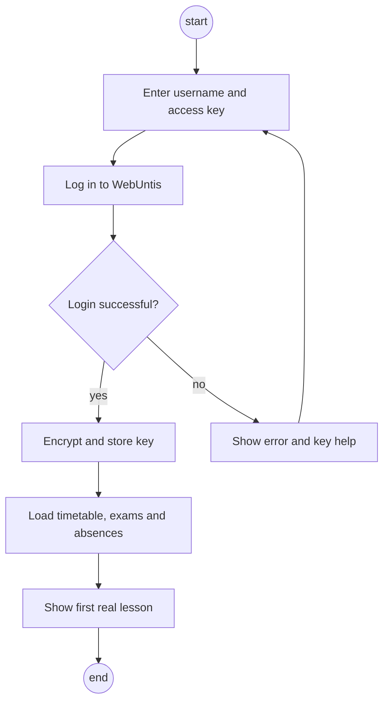

#### F02 · Plan the morning journey

| Characteristic | Description |
| --- | --- |
| Business process | BP1 Getting to school |
| Goal | The student knows when to leave home for the first real lesson. |
| Precondition | WebUntis is connected (F01). |
| Postcondition | A leave-by time exists for the next school day and is updated when lessons change. |
| Involved roles | Student; WebUntis |
| Triggering event | The student saves a route, or a timetable sync finds a changed first lesson. |

**Standard scenario.** The student picks home and school stops, walking times and a buffer. LeoWay shows the leave-by time for the latest fitting connection.

**Non-standard scenario.** The first lesson is cancelled overnight: the next sync moves the leave-by time and the phone alarm (F04). If no connection fits, LeoWay shows the earliest possible arrival.

```screens
Call: Route and alerts
Home stop     Leonding Zentrum
School stop   Meixnerkreuzung
[Edit route]
---
Standard: leave-by time
First lesson  08:00
Bus 19        07:31 → 07:47
Leave by      07:24
---
Non-standard: lesson cancelled
First lesson  08:55  (08:00 cancelled)
Leave by      08:16  (was 07:24)
Alarm moved
```

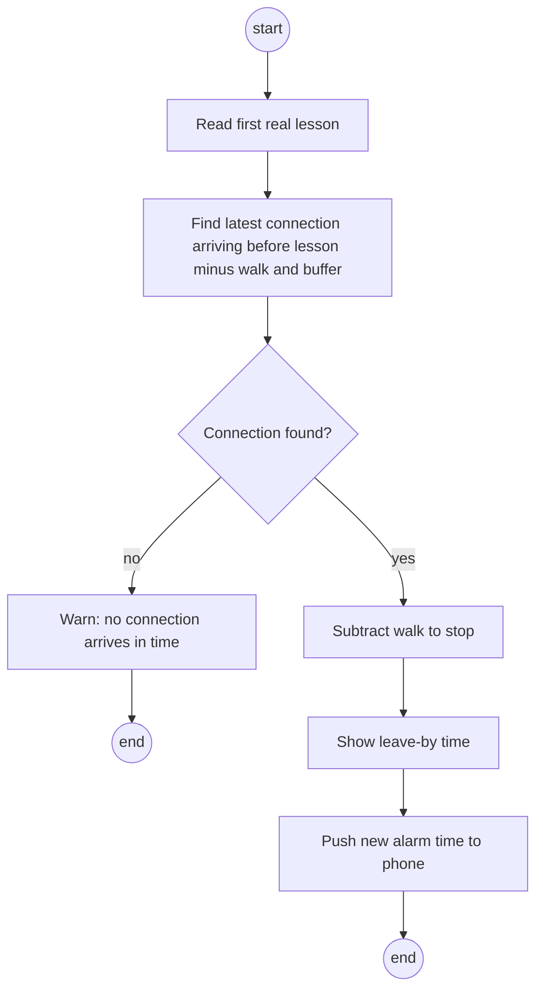

### 2.2 Block B: Alerts

LeoWay watches the student's connection and alerts them in the channels they chose.

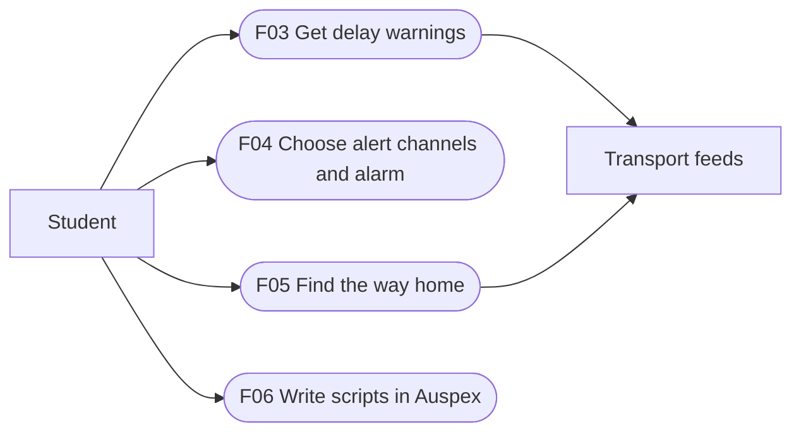

#### F03 · Get delay warnings

| Characteristic | Description |
| --- | --- |
| Business process | BP1 Getting to school |
| Goal | The student learns early that the saved journey will arrive late and gets an alternative. |
| Precondition | A leave-by time exists (F02); at least one alert channel is set (F04). |
| Postcondition | The student has received one warning per channel for the change; the alternative is shown on Home. |
| Involved roles | Student; transport feeds |
| Triggering event | A feed reports a delay or cancellation on the student's connection. |

**Standard scenario.** Bus 19 is +6 min, so the student would arrive 3 minutes late. LeoWay warns and suggests tram 3, adding an exam note if the first lesson is an exam.

**Non-standard scenario.** Without live data for the line, LeoWay shows "timetable only" and the last update time, and sends no delay warning.

```screens
Call: Home
Bus 19        +6 min
[View another connection]
---
Standard: warning
Warning: Bus 19 +6 min, arrive 08:03
Exam in first lesson
Take tram 3 at 07:29 instead
---
Non-standard: no live data
Bus 611       07:10
Timetable only
Last update   05:41
```

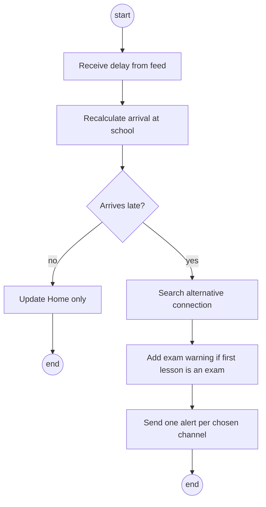

#### F04 · Choose alert channels and alarm

| Characteristic | Description |
| --- | --- |
| Business process | BP1 Getting to school |
| Goal | Alerts reach the student where they look; on Android, a leave-by alarm rings. |
| Precondition | The student is logged in. For the alarm: the Android app is installed. |
| Postcondition | Chosen channels are stored; the Android alarm is set for the current leave-by time. |
| Involved roles | Student; Discord, push service, email |
| Triggering event | The student opens "Route and alerts". |

**Standard scenario.** The student picks Discord and push and gets a test message on each. On Android, the alarm is set for the leave-by time and follows its changes. Channels are built in the order Discord, push, email.

**Non-standard scenario.** Android denies the exact-alarm permission. The app explains why it is needed and offers a normal high-priority notification instead.

```screens
Call: Route and alerts
Alerts        [Choose channels]
Alarm         off
---
Standard: channels set
[x] Discord  [x] Push  [ ] Email
Alarm         on · 07:24
Test message sent
---
Non-standard: no permission
Alarm needs "exact alarms"
[Open settings]
[Use notification instead]
```

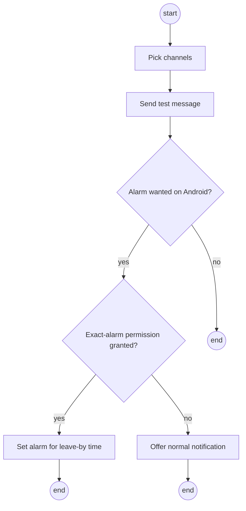

#### F05 · Find the way home

| Characteristic | Description |
| --- | --- |
| Business process | BP1 Getting to school (return trip) |
| Goal | The student sees the next connection home after the actual last lesson. |
| Precondition | WebUntis is connected and a route is saved. |
| Postcondition | Home shows the next journey home. |
| Involved roles | Student; WebUntis; transport feeds |
| Triggering event | The last lesson of the day ends, or a sync finds that lessons end early. |

**Standard scenario.** The last lesson ends at 15:25. LeoWay shows tram 3 at 15:34, allowing the walk to the stop.

**Non-standard scenario.** The last two lessons are cancelled. The next sync moves the journey home to the new end time, 13:45, and shows the next connection after it.

```screens
Call: Home (afternoon)
Way home      [Show]
---
Standard: way home
Last lesson   ends 15:25
Tram 3        15:34 → 15:52
---
Non-standard: early finish
Last lesson   ends 13:45 (changed)
Bus 19        13:51 → 14:06
```

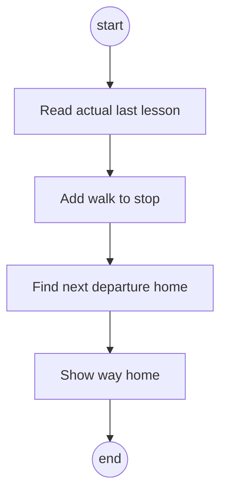

#### F06 · Write alert scripts in Auspex

| Characteristic | Description |
| --- | --- |
| Business process | BP1 Getting to school |
| Goal | Check personal alert conditions using Auspex. |
| Precondition | The student is signed in and has a saved route and alert channel. |
| Postcondition | A checked script is saved, or an error is shown. |
| Involved roles | Student; Auspex runner |
| Triggering event | The student opens Alert scripts and selects Check. |

**Standard scenario.** The student writes a script that checks whether the delay is over five minutes and the first lesson is an exam. The backend gives it delay and exam data, then sends the alert if the result is true. Auspex is a C-like scripting language; this sentence describes the condition, not its syntax.

**Non-standard scenario.** A script has a syntax error: show the error and do not save it as active. A script that hangs or tries to access restricted data must be stopped by the runner. If exam data is missing, manual exam marking is available.

```screens
Call: Route and alerts
[Alert scripts]
---
Standard: checked script
Auspex script editor
Result: valid
[Save and activate]
---
Non-standard: error
Error on line 3
Script not activated
[Edit script]
```

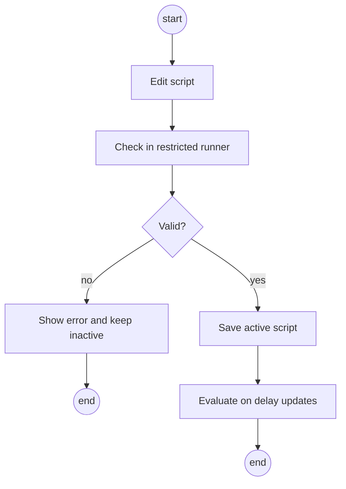


### 2.3 Block C: Delay appeals

LeoWay matches lateness entries with delay records; the form teacher checks the appeal by link or in the optional portal.

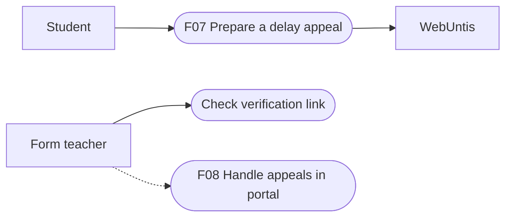

#### F07 · Prepare a delay appeal

| Characteristic | Description |
| --- | --- |
| Business process | BP2 Excusing lateness |
| Goal | The student sends a checkable appeal in under one minute; the form teacher can verify it. |
| Precondition | A lateness entry was synced from WebUntis; a delay record exists for the saved journey. |
| Postcondition | An appeal with a verification token exists; the email is opened in the student's mail app. |
| Involved roles | Student; form teacher; WebUntis |
| Triggering event | The noon or afternoon sync finds a new lateness entry. |

**Standard scenario.** LeoWay shows "You were marked 13 min late; your bus 19 was 11 min late." The student confirms, checks the editable email (line, stop, times, minutes late, verification link) and sends it. The form teacher opens the link and sees only the delay record.

**Non-standard scenario.** No record matches the saved journey and date or the absence is longer than the first lesson: no appeal is suggested. Changed or revoked links show "Link not valid".

```screens
Call: Home
[My lateness / draft appeal]
1 new lateness entry
---
Standard: suggested match
Late 13 min · 08:00–08:13
Bus 19 +11 min at Meixnerkreuzung
[Confirm and draft email]
---
Non-standard: no match
Late 25 min · 08:00–08:25
No recorded delay fits
this lateness entry
```

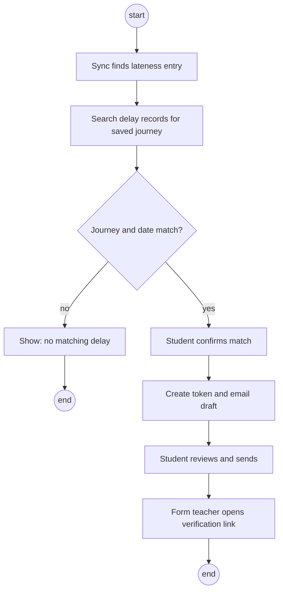

#### F08 · Handle appeals in the teacher portal (optional)

| Characteristic | Description |
| --- | --- |
| Business process | BP2 Excusing lateness |
| Goal | Enrolled form teachers handle appeals in one list instead of by email. |
| Precondition | The teacher is enrolled with a teacher login and assigned to the class. |
| Postcondition | The appeal is marked approved or declined. The teacher still records the decision in WebUntis. |
| Involved roles | Form teacher |
| Triggering event | A student of the teacher's class sends an appeal. |

**Standard scenario.** The teacher opens the portal, sees the appeal with the line's reliability next to it and approves it.

**Non-standard scenario.** The teacher tries to open an appeal from another class. The portal denies access. Teachers who do not enrol keep receiving emails.

```screens
Call: Portal login
School login  [Sign in]
---
Standard: appeal list
3a · 08:13 · Bus 19 +11 min
Line on time 82%
[Approve]  [Decline]
---
Non-standard: other class
Access denied: not assigned
to this class
```

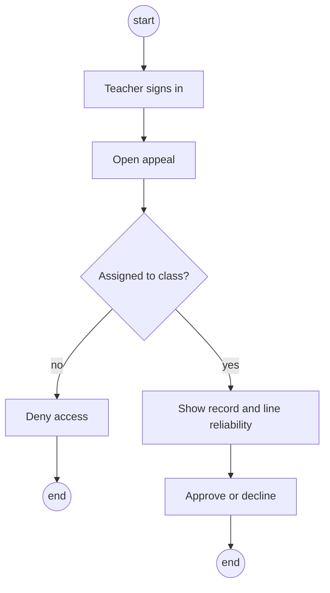

### 2.4 Block D: Delay data and community

Recorded delays feed warnings, appeals, prediction and statistics; students add crowd reports.

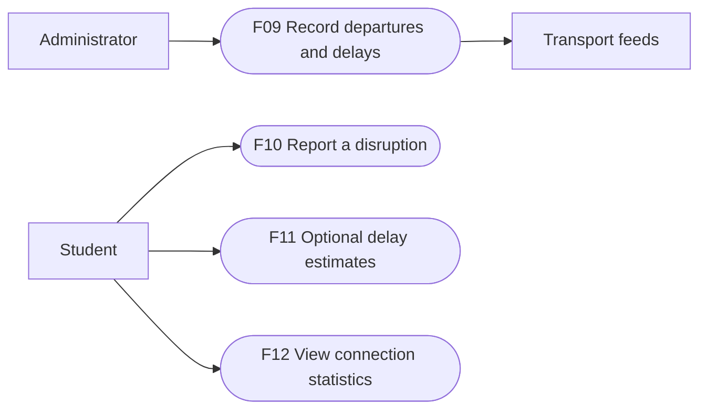

#### F09 · Record departures and delays

| Characteristic | Description |
| --- | --- |
| Business process | BP2 Excusing lateness, BP3 Reporting problem connections |
| Goal | A complete delay history with source and collection time. |
| Precondition | Feed adapters are configured. |
| Postcondition | New delay records are stored; the feed status shows the last update. |
| Involved roles | Administrator; transport feeds |
| Triggering event | The recorder starts, or a feed poll timer fires, also on holidays. |

**Standard scenario.** The recorder fetches Linz AG departures, stores each departure with line, stop, planned time, delay, source and collection time, and updates the feed status.

**Non-standard scenario.** A feed fails: other feeds keep running. Show the failed source and last update time, alert the team and retry later. Cached values are labelled as old.

```screens
Call: Admin · Feed health
[Start / view recorder]
---
Standard: all feeds running
Linz AG live   OK · 12 s ago
MVO timetable  OK · today 03:00
ÖBB timetable  OK · today 03:00
---
Non-standard: feed down
Linz AG live   STALE · 7 min
Retry in 2 min
Team alerted
```

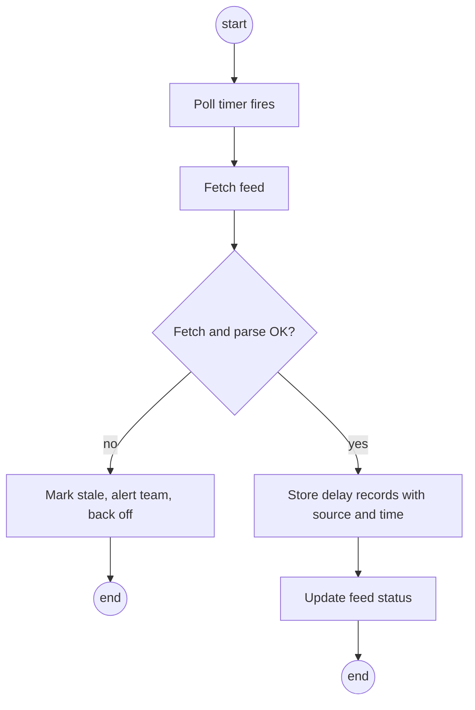

#### F10 · Report a disruption

| Characteristic | Description |
| --- | --- |
| Business process | BP1 Getting to school |
| Goal | Students warn each other before official feeds show a disruption. |
| Precondition | The student is logged in. |
| Postcondition | The report is stored; if the threshold is reached, a warning goes to students using that line. |
| Involved roles | Student |
| Triggering event | The student taps "Report disruption". |

**Standard scenario.** Three accounts report tram 3 at Meixnerkreuzung for the same current disruption. LeoWay warns students on that line, marked as a crowd report.

**Non-standard scenario.** One student reports the same disruption several times. The reports count once and no warning is sent.

```screens
Call: Home
[Report disruption]
---
Standard: report sent
Line   Tram 3
Stop   Meixnerkreuzung
Reported · 2 others agree
---
Non-standard: repeated report
You already reported
this disruption
```

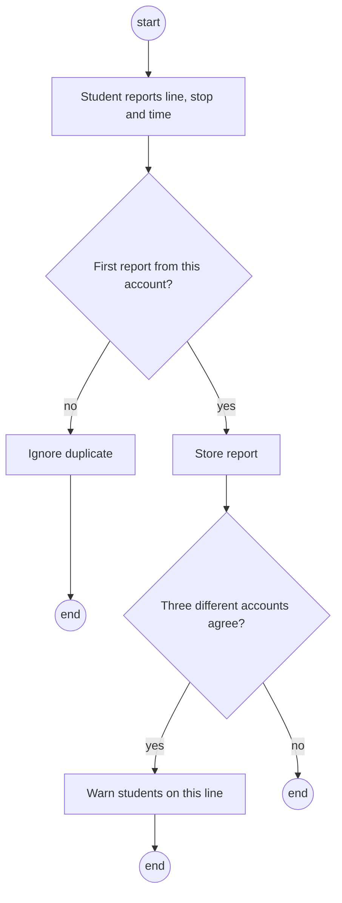

#### F11 · Delay predictions (optional)

| Characteristic | Description |
| --- | --- |
| Business process | BP1 Getting to school |
| Goal | Suggest delay risk and an extra buffer, if a model is added. |
| Precondition | The team has chosen to add this feature and enough history exists. |
| Postcondition | Show a labelled estimate, or keep the normal live-data view. |
| Involved roles | Student; optional prediction service |
| Triggering event | The student opens tomorrow's journey with the feature enabled. |

**Standard scenario.** If we build a model, it uses recorded history to estimate the risk for tomorrow and suggest a buffer. Compare it with "same delay as yesterday" and "average delay of this trip" on later, unseen data. Python is optional if we choose it for training.

**Non-standard scenario.** The feature is not included or there is too little history: show no model estimate. If a trained model loses to a simple method, use the better method and label it. Normal timetable and live-delay alerts still work.

```screens
Call: Tomorrow's journey
[Delay estimate]
---
Standard: optional estimate
Bus 19: high delay risk
Suggested extra buffer: 6 min
Example model output
---
Non-standard: unavailable
No model estimate
Timetable and live delays
still available
```

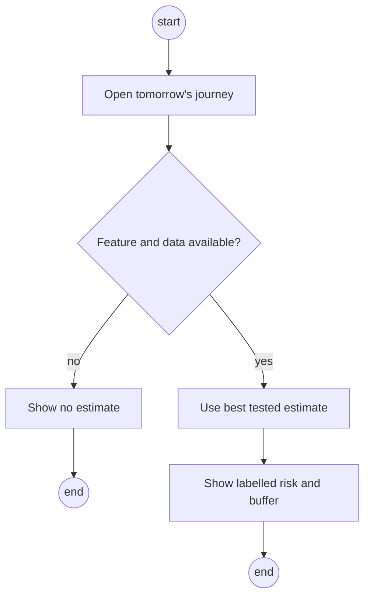


#### F12 · View connection statistics

| Characteristic | Description |
| --- | --- |
| Business process | BP3 Reporting problem connections |
| Goal | Give the student council evidence about unreliable connections. |
| Precondition | Recorded transport data exists for the selected period. |
| Postcondition | Show a connection report or explain that data is missing. |
| Involved roles | Student or student council member |
| Triggering event | The user opens Statistics and selects a period. |

**Standard scenario.** Select a school month. The app lists connections that often arrive after lessons start and lets the user export a report. It uses transport records, not named student attendance.

**Non-standard scenario.** No records exist for the selected period: show "Not enough data" instead of a misleading percentage. No student names appear in the report.

```screens
Call: Menu
[Statistics]
---
Standard: connection report
September: test data
Bus 19: late 34 percent
[Export report]
---
Non-standard: no records
Not enough data
Choose another period
```

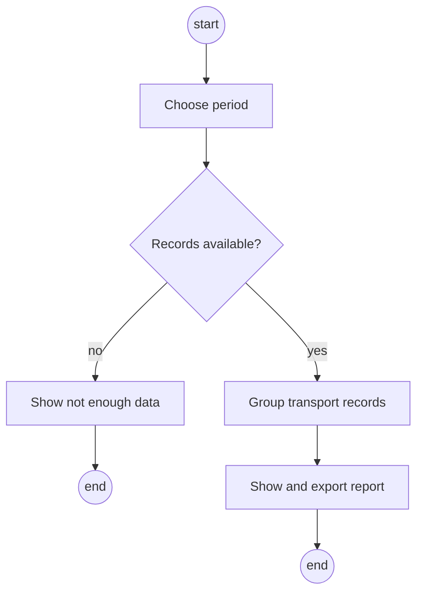


## 3. Non-functional requirements

### 3.1 Usability

Our main users are students checking their phone before or during the journey and form teachers checking an email. The student view uses a departure-board layout: first lesson, leave-by time, line and delay appear together on a phone-width screen without opening another page. Verification links open in the teacher's browser without an account.

Use plain messages, readable labels and keyboard-accessible controls. Check Chrome, Firefox and Safari, a narrow phone screen and the Android app on a real phone. Preparing an appeal from a suggested match must take less than one minute.

### 3.2 Efficiency

These are first test targets, not measured results or confirmed school-wide capacity. Check them after the first prototype and revise them with the team if needed.

| ID | Proposed target and check |
| --- | --- |
| E01 | With 10 test users active together, 95 percent of cached journey requests finish within two seconds on the test server. Record the response times. |
| E02 | Evaluate a newly received delay within 60 seconds. Send the same change only once per chosen channel. Measure channel delivery separately from backend processing. |

Provider update rates can limit how early we detect a delay. Always show the source update time. A failed live feed is marked unavailable; cached values stay clearly labelled as old.

### 3.3 Maintainability

Another group may continue the project. Keep setup steps, the API description and tests in the repository. Review changes and run backend/frontend checks in CI.

Each source has one adapter, and alert channels share one interface. Adding another transport feed or notification channel should not require rewriting the recorder or other adapters. Keep the optional model separate so the main system works without it.

### 3.4 Security

**Confidentiality:** use HTTPS, encrypt WebUntis keys and keep the encryption key outside the repository and database. Never log keys or private school data. Check record ownership on every private request. Teachers in the optional portal only see assigned students; the normal admin view shows feed status, not private records.

**Data integrity:** students cannot change collected transport times. Keep the source, trip, stop, service date and collection time. A student confirms a match but does not edit its evidence. Reject changed or revoked verification tokens.

**Availability:** a failed adapter must not stop the others. Retry failed requests without flooding the source and notify the team if the recorder stops. Keep backups and test a restore on the selected host. Exact backup settings are decided during deployment.

**Auspex:** student scripts must run separately with limited file, data and server access. The prototype must show that a blocked operation is rejected and an endless loop is stopped. The integration is still to be built; the Auspex runtime alone does not establish that protection.

### 3.5 Legal and school constraints

Personal-data handling must follow the GDPR and Austrian Data Protection Act (DSG). Keep only data needed for the feature and provide a short privacy notice explaining its purpose, storage and deletion. The Austrian Data Protection Authority explains the framework in its [privacy overview](https://dsb.gv.at/rechte-pflichten/was-ist-datenschutz).

Do not store GPS, home addresses, WebUntis passwords, absence reasons or notes. Use is voluntary. Keep routes and contact details until account deletion; replace timetable caches on sync. Delete appeals and linked lateness entries at school-year end or account deletion. Keep transport history separate. Deleted accounts must stay deleted after a backup restore.

The form teacher decides whether lateness is excused. LeoWay only reads WebUntis. Follow each provider's data licence, attribution, request limits and storage conditions. Use VAO only with active access under its contract; the system must also work without VAO. There is no native iPhone app; iPhone users use the website.


## 4. Quantity structure

The following is a first sizing example for two classes of 30 students each. These are planning assumptions, not actual class sizes, measured feed volumes or a rollout promise. Replace them with survey and feed measurements during the first sprints.

| Quantity | First estimate | Basis |
| --- | --- | --- |
| Student accounts | 60 | 2 classes x 30 students |
| Saved routes | Up to 120 | Up to 2 routes per student |
| Stop master data | Working budget: 1,000 stops | Count the actual records in the selected timetable imports; only part of them is watched live |
| Stops watched live | 10 | Example set covering common class routes and school stops |
| Recorded departures per day | About 2,000 | 10 stops x 200 departures, assuming one stored observation per departure |
| Raw delay storage per year | About 365 MB before live updates, indexes and backups | 2,000 observations/day x 365 days x an estimated 0.5 kB per observation |
| Alerts per school day | About 240 channel messages | 60 students x 2 alerts x 2 chosen channels |
| Alert payload per day | About 240 kB, plus network overhead | Estimated 1 kB per channel message |
| Journey-view JSON | Initial budget: 50 kB per request | 10 simultaneous view loads transfer about 500 kB, excluding app files |

Saving several delay updates for one departure increases the record count and storage above this base estimate. Measure that update factor with the live-feed spike. WebUntis data is per student. Cache shared transport results; actual request counts depend on source rates and the final sync frequency.

The prediction model is optional and not chosen, so its parameter count, training memory and storage are not estimated yet. Add these only if the team decides to build it. The recorder still collects useful history for appeals and statistics.

Resources: team computers, a continuously running backend/database server and an Android test phone. No fixed server RAM or CPU claim is made before testing. Use the request and storage measurements above to choose the final host and backup capacity.


## 5. System architecture and interfaces

### 5.1 Main parts

Angular provides the website and teacher portal; Capacitor wraps the app for Android. Quarkus handles journeys, the recorder, appeals and alerts. PostgreSQL stores data. Auspex is planned for alert scripts in a restricted runner. Python is optional if we add model training. We use free services and team hardware or school hosting.

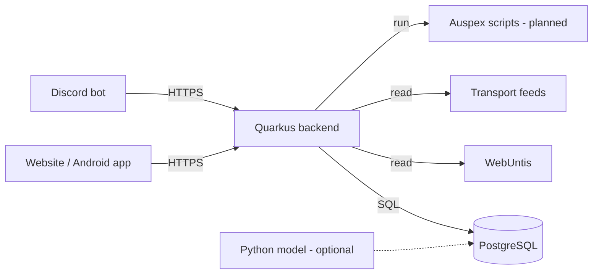

The clients do not connect to the database themselves. The backend checks access and passes only the required delay and exam values to scripts. A script result tells the backend whether to send an alert; the script does not get the main database key. Auspex currently documents its own engine and SQLite, so a direct PostgreSQL connector is not assumed. Test the bridge before allowing student scripts.

### 5.2 Communication and external systems

| Partner | Interface and exchanged data |
| --- | --- |
| Website / Android | REST/JSON over HTTPS: saved routes, lessons, journey results, reports and appeal drafts. Responses include last-update time. |
| PostgreSQL | Backend SQL connection for routes, observations and appeals. Clients and student scripts have no direct connection. |
| WebUntis | Read-only calls through the webuntis adapter using the student's username and access key. Allow login/logout, timetable, timegrid, absences and exams only. |
| Linz AG | Adapter for live departures and delays. The spike checks EFA or GTFS-RT availability, trip IDs, update frequency and source limits. |
| MVO and OeBB | GTFS timetable files imported into a common stop/trip format. They provide scheduled times where live data is missing. |
| VAO | Optional regional source under its active contract. Keep it disabled while usable access is unavailable; use timetables instead. |
| Discord / push / email | One notification interface with a shared event ID. Discord bot messages, device pushes and email alerts carry the line, delay and relevant journey. Appeal emails open in the student's own mail app. |
| Auspex | Proposed runner input: delay minutes and exam flag. Output: alert condition true/false or a script error. The exact process/API bridge is still open. |
| Optional model / weather | History is passed to training only if the model is built. GeoSphere weather can be an optional input. |
| Form teacher | Browser verification page showing the chosen transport record. The optional portal needs an authenticated teacher assigned to the class. |

### 5.3 Refresh and time rules

Read lessons and exams in the evening and before/during the morning commute. Check absences again at noon and later in the afternoon, because teachers may enter lateness later. Students can refresh manually. Keep the polling intervals configurable and within source limits.

When the first real lesson changes, push a versioned alarm update to Android. Replace the old alarm and ignore older versions. Sync again when the app opens; offline or force-stopped phones may receive updates late. If exact alarms are unavailable, offer a normal notification.

Choose a journey arriving before the first real lesson, including the school walk and a buffer. Subtract the walk to the departure stop for leave-by time. Match a lateness entry by saved journey and service date; longer absences are not automatically treated as late arrivals, and the student confirms the match. If WebUntis cannot be used, provide timetable entry or an iCal import as a fallback.

Store timestamps in UTC and show Europe/Vienna local time. Keep the service date separately for overnight trips. Label timetable, predicted and confirmed times correctly. A delay record never proves the student travelled on the vehicle.


<!-- page -->

## 6. Acceptance criteria

Accept each use case against its normal and non-standard scenario below. Use recorded or synthetic data for private records. Keep the test results with the delivered version. The model and teacher portal do not block delivery if the team leaves them out.

| Test | Pass condition |
| --- | --- |
| A01 - F01 | A valid key loads lessons, exams automatically and later lateness entries. A wrong/revoked key shows an error without saving it as working. Forbidden data calls are blocked. |
| A02 - F02 | A route gives the correct leave-by time. A cancelled first lesson changes the time and alarm. No fitting journey gives a warning. Check summer/winter time. |
| A03 - F03 | A late journey creates an alert, an available alternative and an exam note when needed. Without live data, show timetable-only status and no invented live delay. |
| A04 - F04 | Each chosen channel gets a test message once. A real Android phone rings at leave-by time and moves the alarm after an update. Without exact-alarm access, offer a notification. |
| A05 - F05 | Show a connection after the last lesson and the walk to the stop. Cancel the last lessons and show an earlier journey home. |
| A06 - F06 | A valid Auspex script checks delay/exam values. A syntax error keeps it inactive. A blocked file/data operation is rejected and an endless script is stopped. Test manual exam fallback. |
| A07 - F07 | A suggested match opens the correct editable email in under one minute. The link shows the same source record. No match gives no suggested appeal; invalid or revoked links are rejected. |
| A08 - F08 | If built: an assigned teacher sees evidence and can approve/decline. An unassigned teacher is denied; WebUntis is never changed. |
| A09 - F09 | Records keep trip, stop, source, service date and time. A failed feed is marked unavailable while others continue. Retrying does not duplicate observations. |
| A10 - F10 | Three different accounts confirming the same current disruption trigger a crowd-labelled warning. A repeated report from one account is ignored. |
| A11 - F11 | Only if built: compare the model with both simple methods on later data excluded from training. Use the better method if the model loses. With no model/history, normal live alerts still work. |
| A12 - F12 | A known unreliable connection appears in an export without student names. An empty period gives an insufficient-data message instead of a percentage. |
| A13 - Security | One student cannot read another's data. Check teacher assignments, token revocation, account deletion and a restore that does not bring deleted accounts back. |
| A14 - Quality | Measure E01/E02, test keyboard and phone-width use, supported browsers, the Android app and CI. Record actual payload/storage sizes and update the quantity estimates. |


<!-- page -->

### 6.1 Plan until January 2028

The project runs from October 2026 to January 2028, with two-week sprints during school weeks. **Behrang Elyasi is the product owner.** We review this working plan after each sprint and keep final delivery in January 2028.

| Period | Planned result |
| --- | --- |
| Oct-Nov 2026 | Set up the projects, test the live feed and Android alarm, choose hosting and start the recorder. |
| Dec 2026-Jan 2027 | First working version: connect WebUntis, save a route and send a leave-by alert through Discord. |
| Feb-Jun 2027 | Build the website and Android app, delay warnings, changing alarms and delay appeals. Test with students and a form teacher. |
| Jul-Aug 2027 | The recorder continues during holidays. No regular school sprints are planned. |
| Sep-Nov 2027 | Complete crowd reports, the way home, Auspex rules and statistics. Consider the optional model and portal only if time allows. |
| Dec 2027-Jan 2028 | Test the complete system, fix problems, finish setup steps and the user guide, then deliver the final version in January 2028. |

Deliver the code, setup steps, a short user guide and test results. Optional extras must not delay the main features.

### 6.2 Before we start

Prepare team computers, a server and database, an Android phone, test WebUntis access and a Discord bot. Test the Linz AG feed, changing phone alarms and the Auspex connection early. Survey our classes. Software and data sources are listed in section 5.

### 6.3 Still to decide

Settle these points before building the affected feature. Keep the answers in the related GitHub issues.

| Decision | What we need to settle |
| --- | --- |
| Hosting | Team server or LeoCloud? Agree who monitors the recorder and handles backups. |
| Student login | Choose how students sign into LeoWay and reconnect or disconnect WebUntis. |
| Auspex | Test how scripts run separately with limited access to files, data and server resources. |
| Appeals | Agree the email format with form teachers before building it. Decide where teacher addresses come from; use checked manual entry until then. |
| VAO | Define request limits and data retention under the active contract. LeoWay must work without VAO. |

Later, choose the final name. Decide on the optional model and teacher portal once the main features work. If the portal is added, agree teacher login with the school.
