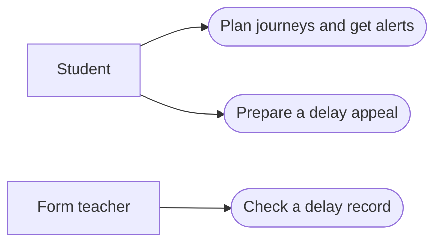
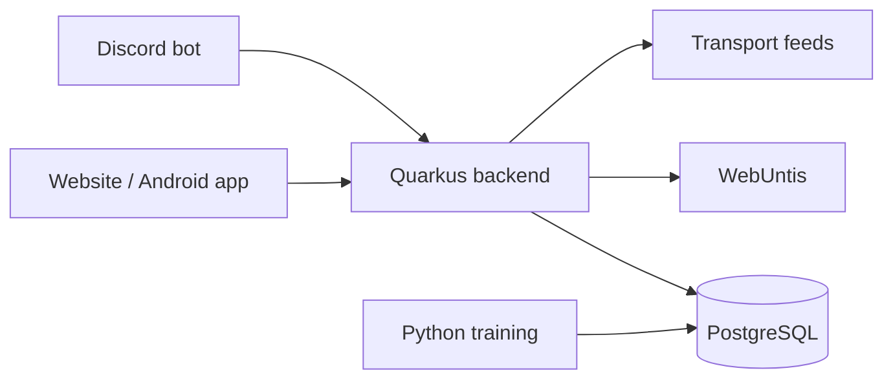
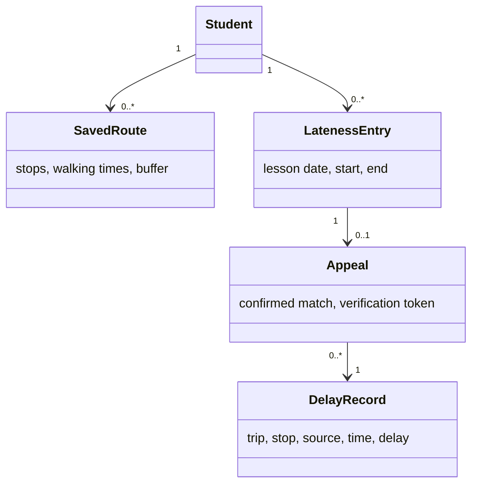

# LeoWay - System Specification

Version 0.5 · 21 October 2026 · Draft

**Team:** LRD (Leo Research Department)

**Authors:** Laurenz (LPuehringerStudent), Ayan (Ayan2310), David (David-Fruehwirt), Behrang (BehrangEl11).

## 1. Initial situation and goal

### 1.1 What is the problem?

Students check WebUntis for their lessons and another app for the bus or tram. They have to work out when to leave themselves. If a lesson is cancelled or transport is delayed, their plan may no longer fit.

When students arrive late, they send the form teacher a photo or screenshot. The teacher cannot easily check whether it shows the right connection and date.

### 1.2 What we want to build

LeoWay connects the school timetable with public transport data. It tells students when to leave, warns about delays and helps them prepare an email with a delay record the teacher can check. Recorded delays also help us find unreliable connections.

LeoWay only reads WebUntis. Students send their own emails, and the form teacher still decides whether lateness is excused. A delay record does not prove that the student was on the vehicle.

### 1.3 Who uses it?



The team also checks whether the transport feeds and the server are working. Teachers can use verification links without an account. The teacher portal is optional.

### 1.4 Important terms

| Term | Meaning |
| --- | --- |
| Access key | The student's WebUntis key, used instead of their password. |
| First real lesson | The first lesson that takes place after timetable changes. |
| Leave-by time | When to leave, including walking time and a buffer. |
| Lateness entry | A short absence at the start of the first lesson in WebUntis. |
| Delay record | A departure and its delay, saved with the source and collection time. |
| Delay appeal | The student's email asking the form teacher to excuse lateness. |

<!-- page -->

## 2. Functional requirements

### 2.1 Getting to school and receiving alerts

#### F01 · Connect WebUntis

The student enters their username and access key. LeoWay reads their lessons, cancellations, substitutions, exams and lateness entries. Exam days are detected automatically. If the key does not work, the app shows an error and lets the student try again.

#### F02 · Plan the morning journey

The student saves their departure stop, school stop, walking times and a buffer. LeoWay uses the first real lesson to find a suitable connection and leave-by time. If that lesson changes, the time is updated. If no connection arrives in time, the app says so.

#### F03 · Get delay warnings

LeoWay watches the saved connection. If a delay would make the student late, it warns them and suggests another connection where possible. If the first lesson is an exam, the warning mentions it. Without live data, the app shows “timetable only”.

#### F04 · Choose alert channels and an alarm

Students choose Discord, push notifications or email. We build Discord first, then push and email. The Android app can set an alarm for the leave-by time and move it after a timetable change. If alarm permission is missing, the app offers a normal notification.

#### F05 · Find the way home

LeoWay shows the next connection home after the actual last lesson, allowing time to walk to the stop. If the last lessons are cancelled, it uses the earlier finish time.

#### F06 · Write personal alert rules

Students can use auspex-lang, a small rule language, for alerts such as “notify me if the delay is over five minutes and the first lesson is an exam”. Invalid rules show an error. Manual exam marking is available if WebUntis exam data is missing.

### 2.2 Simple home screen

```text
Today                         Last sync 05:45
First lesson                  08:55
Leave by                      07:42
Bus 19                        +6 min
[View another connection]     [Report disruption]
[My lateness / draft appeal]  [Route and alerts]
```

<!-- page -->

### 2.3 Delay appeals, records and reports

#### F07 · Prepare a delay appeal

LeoWay looks for a delay record that fits the student's lateness entry and saved journey. The student checks the suggested match and opens an editable email with the line, stop, times, delay and verification link. The student reviews and sends it. If no record fits, LeoWay does not suggest an appeal.

#### F08 · Teacher portal (optional)

Teachers who join can view their students' appeals, check the delay record and the line's reliability, and approve or decline the appeal. They cannot open another class's private appeals. Teachers who do not join keep using email. LeoWay does not write decisions to WebUntis.

#### F09 · Record departures and delays

The recorder runs from the first sprint, including holidays. It saves the line, trip, stop, planned time, reported delay, source and collection time. If a feed fails, other feeds keep running. The app shows when its information was last updated.

#### F10 · Report a disruption

Students can report a problem on a line. When three students report the same disruption, LeoWay warns others on that line. Repeated reports from one account do not count again. The app labels crowd reports clearly and does not present them as official delay evidence.

#### F11 · Get delay predictions

Once enough history is available, we use it to predict delay risk and suggest an extra buffer. We compare the model with “same delay as yesterday” and “average delay of this trip”. If the model is worse, we use the better simple method.

#### F12 · View connection statistics

LeoWay shows which connections often arrive after lessons start. We prepare a report for the student council to discuss with transport providers. Reports do not name students. If there is too little data for a useful result, the app says so.

### 2.4 Example of an appeal

A student is marked 13 minutes late. LeoWay recorded an 11-minute delay on their bus. The student checks the match and sends the draft email. The teacher opens the link to see the recorded delay and decides about the appeal.

The teacher's decision stays separate from the recorded transport data. Students cannot change the recorded times.

<!-- page -->

## 3. Non-functional requirements

### 3.1 Easy to use

The home screen should show the first lesson, leave-by time and current delay clearly on a phone. Messages should use simple wording. We check the website in Chrome, Firefox and Safari, including keyboard use, and test the Android app on a real phone.

Preparing an email from a suggested delay match should take less than one minute. The teacher should be able to open the verification link in a browser without installing anything.

### 3.2 Speed and reliability

The app should load quickly enough to check on the way to school. We test this with several users at once. Exact response-time and user limits will be based on measurements rather than guesses.

When a source is unavailable, the app shows a clear notice and its last update time. Old or predicted times must not look like confirmed live data. The same change should not send duplicate alerts.

### 3.3 Keeping the code manageable

Each data source has its own adapter, so changing one does not require changing all the others. Alert channels use the same notification interface. We review changes, run automated tests and keep setup instructions in the repository.

### 3.4 Privacy and security

Use HTTPS and store WebUntis access keys encrypted. Never store WebUntis passwords, GPS locations, home addresses, absence reasons or notes. Do not put access keys or private school data in logs.

Students can only access their own private records. Teachers in the optional portal can only see assigned students. The normal administrator view shows feed and server status, not private school records.

Verification links are hard to guess, show only the chosen transport record and can be revoked. Keep routes and contact details until account deletion. Delete appeals and linked lateness entries at school-year end or when the account is deleted. Keep the transport history separate.

### 3.5 School rules and data use

Before using real student data, agree access, privacy information and responsibility with school IT and the teacher. Follow the transport providers' data conditions and credit sources where required. The student chooses whether to use LeoWay, and the form teacher keeps deciding about excuses.

## 4. Expected amount of data

We start with students from our own classes. Each student saves a route; students on the same connection can share cached transport data. The recorder's history grows over time, so we measure storage use and request counts during development. These results will help us choose suitable hosting and backup settings.

<!-- page -->

## 5. System architecture and interfaces

### 5.1 Main parts

We use Angular for the website and Capacitor for the Android app. Quarkus runs the backend, PostgreSQL stores the data and Python is used for model training. The project runs on free services and the team's hardware or school hosting.



### 5.2 Data sources

| Partner | What we use |
| --- | --- |
| WebUntis | Lessons, timegrid, exams and absences through the student's key. Allow these calls and login/logout only; block messages, homework and grades. |
| Linz AG | Live departures and delays for supported lines. |
| MVO and ÖBB | Published bus and train timetables. |
| VAO | Keep off until education access and suitable limits are agreed. Use timetables where live regional data is unavailable. |
| GeoSphere Austria | Weather as a possible input for prediction. |

### 5.3 Updates and calculation

Refresh lessons and exams in the evening and before and during the morning commute. Check absences again around noon and later in the afternoon, because teachers may enter lateness after the commute. Students can also refresh manually. Agree request frequency with school IT.

When the first lesson changes, send the new alarm time to the phone. The app replaces the old alarm and checks again when opened. If the phone is offline or the app is stopped, the update may arrive late.

Choose a journey that arrives before the first real lesson, allowing the walk to school and a buffer. Subtract the walk to the departure stop to get the leave-by time. Match lateness to the saved journey and date; the student confirms the suggested record. Store timestamps in UTC and show local Austria time.

### 5.4 Main data objects



<!-- page -->

## 6. Acceptance criteria

We use test data to check the following with the teacher. Each feature can be checked separately. The optional portal is only checked if we build it.

| Test | What should happen |
| --- | --- |
| A01 · F01 | A valid key loads lessons, exams and lateness. Exams are found without manual marking. A wrong key shows an error. Unneeded WebUntis calls are blocked. |
| A02 · F02 | A saved route gives a leave-by time. Cancelling the first lesson changes that time and the Android alarm. Check a change between summer and winter time too. |
| A03 · F03 | A delay that causes late arrival gives a warning and an available alternative. An exam in the first lesson is mentioned. Missing live data shows “timetable only”. |
| A04 · F04 | Alerts reach the chosen channels without duplicates. The alarm works on a real Android phone. Missing alarm permission offers a normal notification. |
| A05 · F05 | The journey home follows the actual last lesson, including when lessons end early. |
| A06 · F06 | A valid delay/exam rule works with a WebUntis exam. Invalid rules show an error. Manual exam marking works as a fallback. |
| A07 · F07 | A matching lateness entry opens the right email draft in under a minute. The link shows the chosen delay record. No match means no suggested appeal. Invalid or revoked links are rejected. |
| A08 · F08 | If built, the teacher can handle an assigned appeal but cannot open another class's private appeals. |
| A09 · F09 | Stored departures have a source and collection time. Disconnecting one feed does not stop the others. |
| A10 · F10 | Three different students trigger a crowd warning. Repeated reports from one account count once. |
| A11 · F11 | Test the model on later data it was not trained on. Compare it with both simple methods and use the better method if the model loses. |
| A12 · F12 | A known unreliable connection appears in the statistics. Student names do not appear in the report. |
| A13 · Privacy | One student cannot read another's records. Deleted accounts lose their private data. Verification links do not show private timetable data. |
| A14 · General | Check phone layout, keyboard use, supported browsers, several users at once and the automated tests. |

### 6.1 Work and delivery

We work in two-week sprints over two school years. Start with the recorder so delay history is collected early, then connect WebUntis and build leave-by alerts. The other features stay in the backlog. We provide the source code, setup steps, a short user guide and test results.

### 6.2 Still to decide

The final name, product owner, hosting, WebUntis permission and request limits, VAO access, teacher email source and optional teacher login are still open. Until email lookup is agreed, the student enters and checks the address. Detailed settings can be decided when we build and test each feature.
