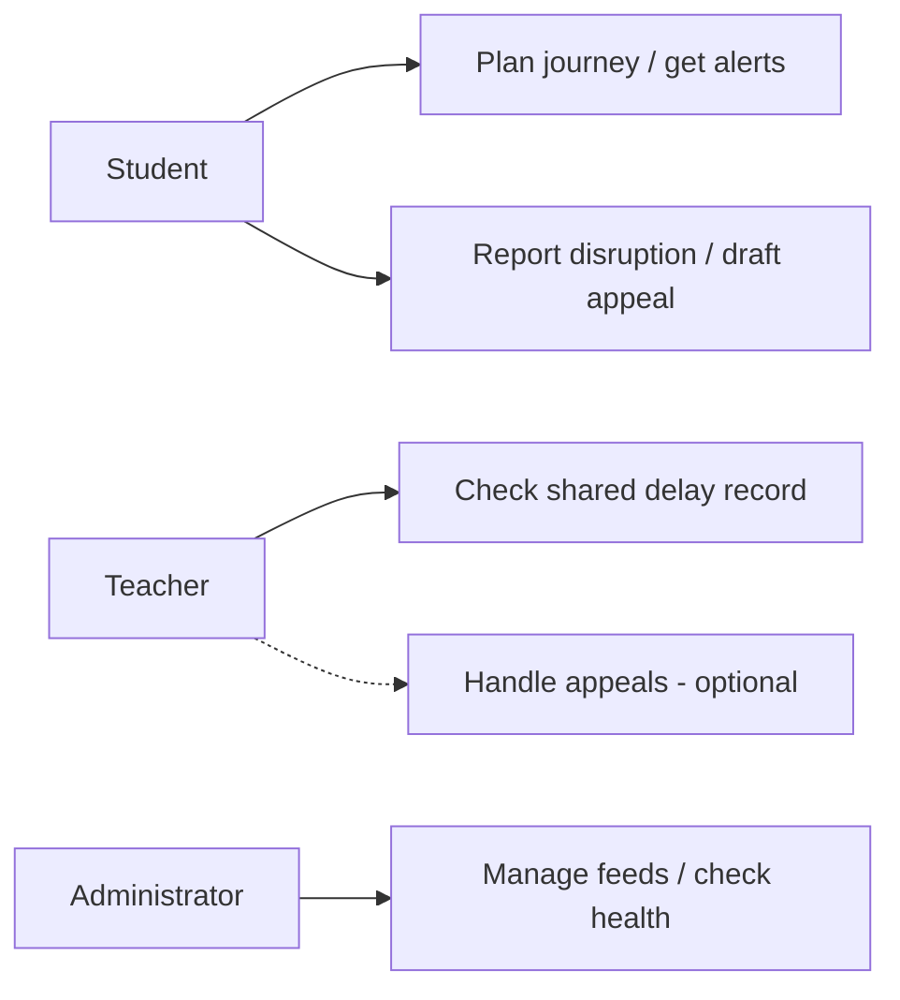
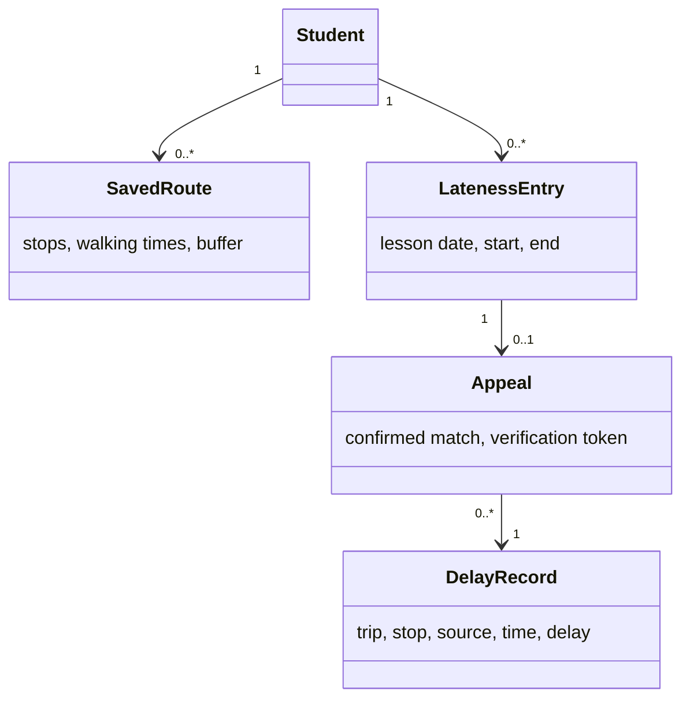

# LeoWay - System Specification

12 October 2026 · Version 0.3 · Draft for review

**Authors:** Laurenz (LPuehringerStudent), Ayan (Ayan2310), David (David-Fruehwirt), Behrang (BehrangEl11).

**Document owner:** David (David-Fruehwirt).

## 1. Purpose and scope

### 1.1 Situation and goal

Students may miss timetable changes or notice transport delays too late. Teachers receive photos and screenshots as delay evidence. LeoWay joins school and transport times, warns students and prepares appeals with a record teachers can check.

This is a short HTL Pflichtenheft. LeoWay is a working name. Values marked **proposed** are draft settings for review with the teacher.

### 1.2 Users and limits

Students save a route, get alerts and prepare appeals. Teachers check shared records; an optional portal lets them handle appeals. Administrators manage feeds and system health.

LeoWay only reads WebUntis. Students send their own emails. Teachers decide about appeals. A delay record shows what a source reported, not whether a student was on the vehicle.

No GPS, home addresses, writes to WebUntis or native iPhone app. iPhone users use the website. Other schools, indoor navigation and a public delay dataset are later extensions.

### 1.3 Terms

| Term | Meaning |
| --- | --- |
| First real lesson | The first lesson that still takes place after cancellations and changes. |
| Exam day | A day with an exam from WebUntis. Manual marking is a fallback when exam data is missing. |
| Leave-by time | When to leave to reach that lesson, including walking time and a buffer. |
| Lateness entry | A WebUntis absence starting at the first real lesson and ending within it; longer absences are not matched automatically. |
| Delay record | A stored departure with its line, stop, planned time, reported delay, source and collection time. |
| Delay appeal | An email linking a lateness entry to a delay record. |
| Verification link | A link showing only the shared transport record. |
| Crowd report | A disruption reported by a student; several reports can trigger a warning. |
| auspex-lang | A small rule language for personal alerts, such as a delay over five minutes on an exam day. |

<!-- page -->

## 2. Functional requirements

Each feature has its own acceptance test. Work follows the proposal's backlog; there are no fixed yearly releases.

| ID | Required behaviour |
| --- | --- |
| F01 | Record available departures and delays continuously, including holidays. Keep the source and collection time. |
| F02 | Connect WebUntis with the student's username and access key. Read lesson changes, exams and lateness entries. Never store absence reasons or notes. |
| F03 | Save the stop, route, walking times and buffer. Calculate leave-by time from the first real lesson and update it when lessons change. |
| F04 | Show delays. Warn if the journey is expected to arrive late and suggest another connection when possible. Add an extra warning if the first real lesson is an exam. |
| F05 | Students pick one or more alert channels. Build channels in this order: Discord, push, email. Android has a leave-by alarm; explain missing permission and offer a normal notification. |
| F06 | Suggest a delay match for a lateness entry. The student checks it, then opens an editable email with journey details and a verification link. |
| F07 | Group reports for the same line, stop and time. Proposed: three different accounts within ten minutes trigger a warning. Keep it separate from official evidence. |
| F08 | Use delay history to suggest a risk and a personal buffer. Use a baseline when the model is unavailable or worse. |
| F09 | Show connections that often arrive after lessons start. Statistics must not name students. |
| F10 | Show the next journey home after the actual last lesson, including early finishes. |
| F11 | Let students write auspex-lang alert rules using exam days from WebUntis. Allow manual marking if exam data is missing. Reject invalid rules with a clear error. |
| F12 | Optional: enrolled teachers can check, approve or decline assigned students' appeals and see line reliability. Other teachers use email. |

### 2.1 Main student flow

Connect WebUntis → save route → check first lesson → get leave-by alert → get delay updates. If marked late: check suggested match → open email draft → review and send.

<!-- page -->

## 3. System design

### 3.1 Use cases



### 3.2 Parts and interfaces

Angular provides the website. Capacitor wraps it for Android. Quarkus runs the backend, PostgreSQL stores data and Python trains predictions. Source adapters feed the recorder; services calculate journeys, appeals and alerts. All channels use the same alert ID to avoid duplicates.

**WebUntis:** allow login/logout and only the student's timetable, timegrid, absence and exam calls (getExamsForRange). Block messages, homework, grades and other data calls. Read exam dates and times automatically; use manual marking only when exam data is missing.

Proposed sync times in Europe/Vienna: lessons and exams at 20:00 for the next day, 05:00 and every 15 minutes from 05:00 to 10:00; absences at 12:00 and 16:00. Allow a manual refresh. Cache data and back off after errors; confirm limits with school IT.

After a lesson change, push the new alarm time and a version to the phone. The app cancels the old alarm and sets the new one. Ignore older versions. Sync again when the app opens. If updates cannot arrive, show the last sync time; alarm changes are not guaranteed while offline or force-stopped.

**Transport:** use Linz AG live data and MVO/ÖBB timetables. VAO stays off until education access and limits are agreed. The stored Start contract allows up to 100 queries/day, so it is not suitable for polling per student. Without live data, show “timetable only”.

### 3.3 Domain model



### 3.4 Calculations and time

Choose a journey that arrives before the first lesson, allowing the school walk and buffer. Subtract the walk to the stop from departure time. If none fits, show a warning.

Keep the trip's service date. Store timestamps in UTC; display Europe/Vienna time. Mark predicted times as predictions. Proposed: suggest a match if the saved journey's school arrival is within 15 minutes of the lateness end. The student confirms uncertain matches.

<!-- page -->

## 4. Quality and operation

### 4.1 Quality targets

These are proposed targets on the agreed test server.

| ID | Target |
| --- | --- |
| Q01 | Support 100 accounts and 20 active users at once. At least 95% of cached API requests finish within two seconds. |
| Q02 | Evaluate a received delay within 60 seconds. Send only one alert per channel for the same change; measure delivery time separately. |
| Q03 | A failed feed must not stop other feeds. Show update times; mark live data older than five minutes as stale. |
| Q04 | Three students must each prepare an appeal from a matched entry in under one minute using test data. |
| Q05 | Check current Chrome, Firefox and Safari, phone widths and keyboard use. Proposed minimum: Android 10. Test the Capacitor app, alarms and alarm changes on a real supported phone. |
| Q06 | Adapter, timetable, matching and permission tests must pass in CI. Review code before deployment. |

### 4.2 Privacy and access

Use HTTPS. Encrypt WebUntis keys and keep the encryption key outside the database and repository. Do not log keys or private school data.

The API checks record ownership on every private request. The administrator role has health/feed endpoints only, not student-data endpoints. Database access uses a separate, restricted support account; record and review any support access.

Verification links use random, unguessable tokens. Proposed: expire after 30 days and allow revocation. Show only transport evidence, source and collection time. Invalid links cannot read or change records. The optional teacher portal needs school-approved login and checked class assignments.

### 4.3 Storage and recovery

Keep routes and contacts until account deletion; replace timetable caches on sync. Keep appeals and linked lateness entries until school-year end or account deletion. Keep public transport history separately.

Proposed: encrypted daily backups kept for seven days, with a restore test before release. Deleted accounts stay deleted after a restore. Agree hosting, privacy information and responsibility before using real student data.

### 4.4 Home screen sketch

```text
Today                         Last sync 05:45
First lesson                  08:55
Leave by                      07:42
Bus 19                        +6 min
[View another connection]     [Report disruption]
[My lateness / draft appeal]  [Route and alerts]
```

<!-- page -->

## 5. Acceptance and delivery

### 5.1 Acceptance tests

The teacher and team agree which features are delivered. Each feature passes its own test; later features do not block earlier ones. Use test data for private records.

| Test | Pass condition |
| --- | --- |
| A01 · F01, Q03 | Disconnect a feed. Stored records keep source/time, old data is marked stale and other feeds keep working. |
| A02 · F02 | Sync detects an exam without manual marking. Noon/evening sync finds a new lateness entry. Reject longer absences and forbidden data calls. |
| A03 · F03 | Cancel the first lesson overnight and in the morning. Update leave-by time and replace the phone alarm. Ignore an older push; check offline recovery and a daylight-saving change. |
| A04 · F04 | Add a delay that causes late arrival. Show a warning and an available alternative. Add the extra warning when the first lesson is an exam. Without live data, show “timetable only”. |
| A05 · F05, Q02 | Send once to each chosen channel within the processing target. On a real Android phone, test the alarm and denied permission. |
| A06 · F06, Q04 | Prepare the correct draft in under one minute. Its link shows the chosen record. Reject changed, expired and revoked tokens. |
| A07 · F07 | Three accounts trigger a warning. Repeated reports from one account count once. |
| A08 · F08 | Test on later dates excluded from training. Compare mean delay error with “same delay as yesterday” and “average delay of this trip”. Keep the stronger baseline if the model loses. |
| A09 · F09 | Show a known late connection in statistics without student identities. |
| A10 · F10 | End lessons early; show the next connection after the new end time. |
| A11 · F11 | A delay/exam rule uses a WebUntis exam without manual marking. Test manual fallback with missing exam data. An invalid rule shows an error. |
| A12 · F12 | If built, a teacher handles an assigned appeal but cannot access another class. |
| A13 · Access | Student A cannot read B's records. An administrator cannot use private endpoints. Deletion removes private data and survives a backup restore. |
| A14 · Q01, Q05-Q06 | Meet the load target, browser/device checks and CI checks; record the results. |

### 5.2 Delivery and open decisions

Deliver code, database changes, tests, deployment steps, a short user guide and test results. Work in two-week sprints. Update the backlog and this document when requirements change.

Confirm the final name, product owner, hosting, WebUntis permission/limits, VAO access, teacher email source and optional teacher login. Until email lookup is agreed, the student enters and checks the address. Review proposed settings with the teacher before release.

### 5.3 Sources

Scope: [project proposal](LeoWay%20%E2%80%94%20Project%20Proposal.pdf), 8 October 2026. Changes: [issue #1](https://github.com/LPuehringerStudent/LeoWay/issues/1) and [issue #2](https://github.com/LPuehringerStudent/LeoWay/issues/2). VAO limit: [stored Start contract](VAO%20GmbH_VAO_Start_Vertrag_2025_eF.pdf), section 1.3. Structure: [HTL Leonding example](https://htl-leonding-project.github.io/leo-code/system-specification.html). This is an HTL-style specification, not a claim of certified standards compliance.
