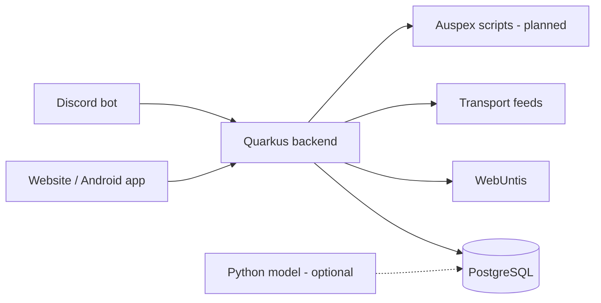
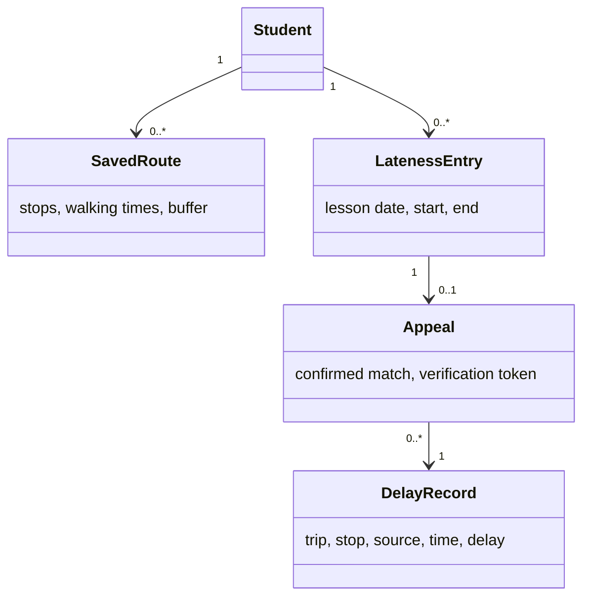

# LeoWay - System Specification

Version 0.6 · 21 October 2026 · Draft

**Team:** LRD (Leo Research Department)

**Authors:** Laurenz (LPuehringerStudent), Ayan (Ayan2310), David (David-Fruehwirt), Behrang (BehrangEl11).

## 1. Initial situation and goal

### 1.1 What is the problem?

Students check WebUntis for their lessons and another app for the bus or tram. They have to work out when to leave themselves. If a lesson is cancelled or transport is delayed, their plan may no longer fit.

When students arrive late, they send the form teacher a photo or screenshot. The teacher cannot easily check whether it shows the right connection and date.

### 1.2 What we want to build

LeoWay connects the school timetable with public transport data. It tells students when to leave, warns about delays and helps them prepare an email with a delay record the teacher can check. Recorded delays also help us find unreliable connections.

LeoWay only reads WebUntis. Students send their own emails, and the form teacher still decides whether lateness is excused. A delay record does not prove that the student was on the vehicle.

### 1.3 Who uses it?

The team checks feeds and server status. Teachers check links without an account; the portal is optional. iPhone users use the website. We are not building a native iPhone app.

### 1.4 Important terms

| Term | Meaning |
| --- | --- |
| Access key | The student's WebUntis key, used instead of their password. |
| First real lesson | The first lesson that takes place after timetable changes. |
| Leave-by time | When to leave, including walking time and a buffer. |
| Lateness entry | A short absence at the start of the first lesson in WebUntis. |
| Delay record | A departure and its delay, saved with the source and collection time. |
| Delay appeal | The student's email asking the form teacher to excuse lateness. |

<!-- page -->

## 2. Functional requirements

### 2.1 Getting to school and receiving alerts

#### F01 · Connect WebUntis

The student enters their username and access key. LeoWay reads their lessons, cancellations, substitutions, exams and lateness entries. Exam days are detected automatically. If the key does not work, the app shows an error and lets the student try again.

#### F02 · Plan the morning journey

The student saves their departure stop, school stop, walking times and a buffer. LeoWay uses the first real lesson to find a suitable connection and leave-by time. If that lesson changes, the time is updated. If no connection arrives in time, the app says so.

#### F03 · Get delay warnings

LeoWay watches the saved connection. If a delay would make the student late, it warns them and suggests another connection where possible. If the first lesson is an exam, the warning mentions it. Without live data, the app shows “timetable only”.

#### F04 · Choose alert channels and an alarm

Students choose Discord, push notifications or email. We build Discord first, then push and email. The Android app can set an alarm for the leave-by time and move it after a timetable change. If alarm permission is missing, the app offers a normal notification.

#### F05 · Find the way home

LeoWay shows the next connection home after the actual last lesson, allowing time to walk to the stop. If the last lessons are cancelled, it uses the earlier finish time.

#### F06 · Write personal alert rules

We plan to use [Auspex](https://github.com/auspex-lang/auspex), a C-like scripting language, to check custom alert conditions. The backend provides delay and exam data and sends the resulting alerts. Example condition: delay over five minutes and first lesson is an exam. This is an explanation, not Auspex syntax. Invalid scripts show an error. Manual exam marking remains a fallback.

<!-- page -->

### 2.2 Delay appeals, records and reports

#### F07 · Prepare a delay appeal

LeoWay looks for a delay record that fits the student's lateness entry and saved journey. The student checks the suggested match and opens an editable email with the line, stop, times, delay and verification link. The student reviews and sends it. If no record fits, LeoWay does not suggest an appeal.

#### F08 · Teacher portal (optional)

Teachers who join can view their students' appeals, check the delay record and the line's reliability, and approve or decline the appeal. They cannot open another class's private appeals. Teachers who do not join keep using email. LeoWay does not write decisions to WebUntis.

#### F09 · Record departures and delays

The recorder runs from the first sprint, including holidays. It saves the line, trip, stop, planned time, reported delay, source and collection time. If a feed fails, other feeds keep running. The app shows when its information was last updated.

#### F10 · Report a disruption

Students can report a problem on a line. When three students report the same disruption, LeoWay warns others on that line. Repeated reports from one account do not count again. The app labels crowd reports clearly and does not present them as official delay evidence.

#### F11 · Delay predictions (optional)

We may add a model to predict delays and suggest an extra buffer. This depends on the available history and time left after the main features work. If we build it, compare it with “same delay as yesterday” and “average delay of this trip”. Python is only needed if we choose it for model training. LeoWay must work without a model.

#### F12 · View connection statistics

LeoWay shows which connections often arrive after lessons start. We prepare a report for the student council to discuss with transport providers. Reports do not name students. If there is too little data for a useful result, the app says so.

### 2.3 Example of an appeal

A student is marked 13 minutes late. LeoWay recorded an 11-minute delay on their bus. The student checks the match and sends the draft email. The teacher opens the link to see the recorded delay and decides about the appeal.

The teacher's decision stays separate from the recorded transport data. Students cannot change the recorded times.

<!-- page -->

## 3. Non-functional requirements

### 3.1 Easy to use

The home screen should show the first lesson, leave-by time and current delay clearly on a phone. Messages should use simple wording. We check the website in Chrome, Firefox and Safari, including keyboard use, and test the Android app on a real phone.

Preparing an email from a suggested delay match should take less than one minute. The teacher should be able to open the verification link in a browser without installing anything.

### 3.2 Speed and reliability

The app should load quickly enough to check on the way to school. We test this with several users at once. Exact response-time and user limits will be based on measurements rather than guesses.

When a source is unavailable, the app shows a clear notice and its last update time. Old or predicted times must not look like confirmed live data. The same change should not send duplicate alerts.

### 3.3 Keeping the code manageable

Each data source has its own adapter, so changing one does not require changing all the others. Alert channels use the same notification interface. We review changes, run automated tests and keep setup instructions in the repository.

### 3.4 Privacy and security

Use HTTPS and store WebUntis access keys encrypted. Never store WebUntis passwords, GPS locations, home addresses, absence reasons or notes. Do not put access keys or private school data in logs.

Students can only access their own private records. Teachers in the optional portal can only see assigned students. The normal administrator view shows feed and server status, not private school records.

Verification links are hard to guess, show only the chosen transport record and can be revoked. Keep routes and contact details until account deletion. Delete appeals and linked lateness entries at school-year end or when the account is deleted. Keep the transport history separate.

### 3.5 School rules and data use

Before using real student data, agree access, privacy information and responsibility with school IT and the teacher. Follow the transport providers' data conditions and credit sources where required. The student chooses whether to use LeoWay, and the form teacher keeps deciding about excuses.

## 4. Expected amount of data

We start with students from our own classes. Each student saves a route; students on the same connection can share cached transport data. The recorder's history grows over time, so we measure storage use and request counts during development. These results will help us choose suitable hosting and backup settings.

<!-- page -->

## 5. System architecture and interfaces

### 5.1 Main parts

We use Angular for the website, Capacitor for Android, Quarkus for the backend and PostgreSQL for data. Python is optional if we add model training. Auspex is planned for alert scripts; its backend connection and safe execution still need testing. We use free services and team hardware or school hosting.

### 5.2 Data sources

| Partner | What we use |
| --- | --- |
| WebUntis | Lessons, timegrid, exams and absences through the student's key. Allow these calls and login/logout only; block messages, homework and grades. |
| Linz AG | Live departures and delays for supported lines. |
| MVO and ÖBB | Published bus and train timetables. |
| VAO | Keep off until education access and suitable limits are agreed. Use timetables where live regional data is unavailable. |
| GeoSphere Austria | Optional weather input if we add a prediction model. |

### 5.3 Updates and calculation

Refresh lessons and exams in the evening and morning. Check absences at noon and in the afternoon, because teachers may enter lateness later. Allow manual refresh and agree request frequency with school IT.

Lesson changes send a new alarm time to the phone. Replace the old alarm and sync when opened. Offline or stopped apps may receive updates late.

Pick a journey arriving before the first real lesson, including the school walk and buffer. Subtract the walk to the stop for leave-by time. Match lateness by saved journey and date; the student confirms. Store UTC timestamps and show local Austrian time.

### 5.4 Main data objects

<!-- page -->

## 6. Acceptance criteria

We use test data to check the following with the teacher. Each feature can be checked separately. The portal and model are only checked if we build them; leaving them out does not block delivery of the main features.

| Test | What should happen |
| --- | --- |
| A01 · F01 | A valid key loads lessons, automatic exams and lateness. Reject wrong keys and unneeded WebUntis calls. |
| A02 · F02 | A route gives a leave-by time. A cancelled lesson updates the time and alarm. Check summer/winter time changes. |
| A03 · F03 | A late journey triggers a warning, available alternative and exam note when needed. Missing live data shows “timetable only”. |
| A04 · F04 | Chosen channels receive alerts once. Test the Android alarm on a phone and the notification fallback when permission is denied. |
| A05 · F05 | The way home follows the actual last lesson, including early finishes. |
| A06 · F06 | An Auspex script checks delay/exam data. Invalid scripts show an error; manual exam fallback works. |
| A07 · F07 | Open the correct email draft in under a minute; its link shows the matching record. Reject invalid/revoked links. No match means no suggested appeal. |
| A08 · F08 | If built, teachers handle assigned appeals but cannot access another class. |
| A09 · F09 | Records keep source and time. One failed feed does not stop the others. |
| A10 · F10 | Three students trigger a crowd warning. One account's repeated reports count once. |
| A11 · F11 | Only if added: test the model on later, unseen data against both simple methods. If omitted, the main app still works. |
| A12 · F12 | A known unreliable connection appears in statistics without student names. |
| A13 · Privacy | Block other students' private records. Delete account data. Verification links show no private timetable data. |
| A14 · General | Check phone layout, keyboard use, browsers, several users at once and automated tests. |

<!-- page -->

### 6.1 Plan until January 2028

The project runs from October 2026 to January 2028. We work in two-week sprints during school weeks. **Behrang Elyasi is the product owner** and helps the team set backlog priorities. These are planned milestones; we adjust tasks during sprint reviews while keeping the January 2028 deadline.

| Period | Planned result |
| --- | --- |
| Oct-Nov 2026 | Agree school access, test the live feed and Android alarm, set up hosting and start the recorder. |
| Dec 2026-Jan 2027 | First working version: connect WebUntis, save a route and send a leave-by alert through Discord. |
| Feb-Jun 2027 | Build the website and Android app, delay warnings, changing alarms and delay appeals. Test with students and a form teacher. |
| Jul-Aug 2027 | The recorder continues during holidays. No regular school sprints are planned. |
| Sep-Nov 2027 | Add crowd reports, the way home, Auspex rules and connection statistics. Consider the optional model and teacher portal only if the main features are working and time allows. |
| Dec 2027-Jan 2028 | Test the complete system, fix problems, finish setup steps and the user guide, then deliver the final version in January 2028. |

The final delivery includes the code, setup steps, a short user guide and test results. If time gets tight, the optional model and teacher portal come after the main features.

### 6.2 Before we start

Agree WebUntis access and sync limits with school IT. Agree the appeal email format with form teachers before building that feature. Choose hosting. Follow up VAO education access; the project must also work without it. Test the Linz AG feed and Android alarm early, and survey our classes.

Prepare team computers, a server for the backend and database, and a real Android phone for alarm tests. Set up test WebUntis access and a Discord bot. Build the Auspex runtime and test passing delay/exam data to it. Software and data sources are listed in section 5.

Still open: the final name, how students sign into LeoWay, teacher email lookup, optional teacher login and safe Auspex execution. Until email lookup is agreed, students enter and check the teacher's address. Decide login and script access before implementing those features.
