# LeoWay - System Specification

Version 0.4 · Draft for review

**Team:** LRD (Leo Research Department)

**Authors:** Laurenz (LPuehringerStudent), Ayan (Ayan2310), David (David-Fruehwirt), Behrang (BehrangEl11).

## 1. Initial situation and goal

### 1.1 Application domain

Most HTL Leonding students come by public transport: Linz AG bus 19 at Limesstraße, trams 3 and 4 and buses 11, 19 and 191 at Meixnerkreuzung, regional OÖVV buses such as 611 and 618, and ÖBB trains. Lessons start at 07:05 (period 0) or 08:00 (period 1).

The school plans lessons in WebUntis, including cancellations, substitutions and exams. Teachers record late arrivals there as a short absence; the form teacher decides whether it is excused. Linz AG publishes live departures; the other operators publish timetables. LeoWay connects the student's WebUntis data with recorded transport delays.

### 1.2 Terms

| Term | Meaning |
| --- | --- |
| Access key | The student's WebUntis key (Profil → Freigaben), used instead of the password. |
| Form teacher | The class teacher (Klassenvorstand) who decides about excusing lateness. |
| First real lesson | The first lesson that still takes place after cancellations and changes. |
| Exam day | A day with an exam (e.g. a Schularbeit) from WebUntis. Manual marking is a fallback when exam data is missing. |
| Leave-by time | When to leave home to reach the first real lesson, including walking time and a buffer. |
| Lateness entry | A WebUntis absence starting at the first real lesson and ending within it; longer absences are not matched automatically. |
| Delay record | A stored departure with its line, stop, planned time, reported delay, source and collection time. |
| Delay appeal | An email from the student to the form teacher that links a lateness entry to a delay record. |
| Verification link | A link in the appeal showing only the shared delay record. |
| Crowd report | A disruption reported by a student; several reports can trigger a warning. |
| auspex-lang | A small rule language for personal alerts, such as a delay over five minutes on an exam day. |

### 1.3 Business processes today

**BP1 · Getting to school.** The student checks WebUntis for changes and, separately, Scotty or the Linz AG app for departures, and works out the leave-by time in their head. Delays are usually noticed at the stop, too late for an earlier connection.

**BP2 · Excusing lateness.** The teacher in the first lesson records a lateness entry in WebUntis. The student sends a photo of the vehicle display or a Scotty screenshot to the form teacher, who cannot check whether it is genuine or from that morning.

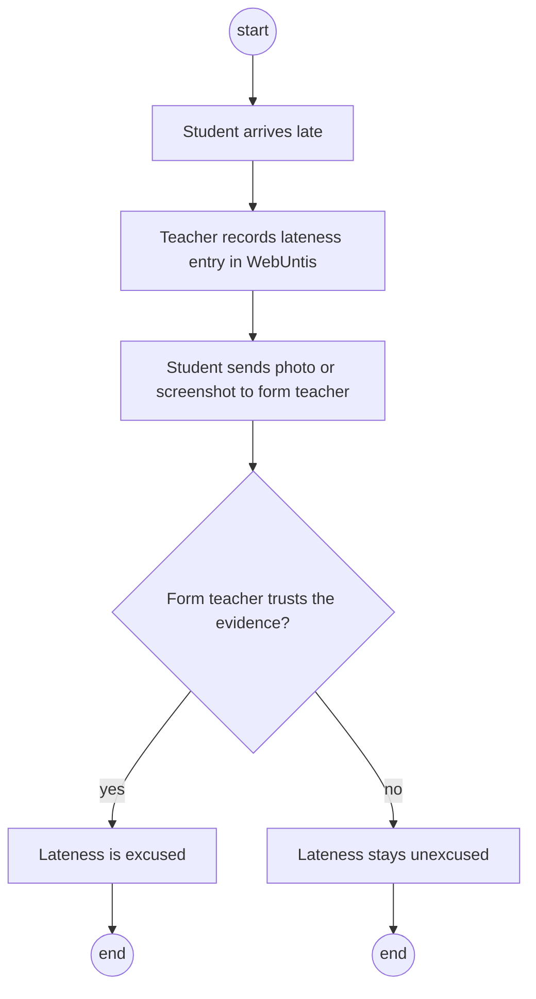

**BP3 · Reporting problem connections.** Nobody collects evidence about connections that are often late, so the student council has nothing to take to Linz AG or OÖVV.

### 1.4 Goal

| Goal | Target |
| --- | --- |
| Timetable-aware alerts | Every alert uses the student's first real lesson, including cancellations, substitutions and exams (BP1). |
| Early delay warnings | A student whose saved journey will arrive late is warned and offered another connection where one exists (BP1). |
| Trustworthy appeals | A late student prepares an appeal in under one minute; the form teacher checks it through the verification link (BP2). |
| Data history | The delay recorder runs continuously from the first sprint, including holidays (BP3). |
| Crowd reports | A disruption confirmed by several students triggers a warning, often before official feeds show it. |
| Prediction | The model beats two baselines: "same delay as yesterday" and "average delay of this trip". |
| School statistics | One report on connections that regularly arrive after lessons start, handed to the student council (BP3). |

**Limits:** LeoWay only reads WebUntis. Students send appeals themselves and teachers still decide; a delay record shows what a source reported, not that the student was on the vehicle. Not included: GPS, home addresses and a native iPhone app (iPhone users use the website). Other schools, indoor navigation and a public delay dataset are later extensions.

## 2. Functional requirements

Requirements are grouped into four blocks, each with a use case diagram. Use cases are numbered F01–F12 and each has its own acceptance test in section 6. Student use cases start from the home screen, called **Home** below:

```text
Today                         Last sync 05:45
First lesson                  08:55
Leave by                      07:42
Bus 19                        +6 min
[View another connection]     [Report disruption]
[My lateness / draft appeal]  [Route and alerts]
```

### 2.1 Block A: Timetable and leave-by time

The student connects WebUntis once and saves a route; LeoWay then calculates the leave-by time every school day.

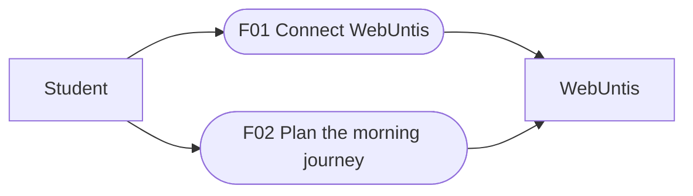

#### F01 · Connect WebUntis

| Characteristic | Description |
| --- | --- |
| Business process | BP1 Getting to school, BP2 Excusing lateness |
| Goal | LeoWay can read the student's lessons, exams and lateness entries. |
| Precondition | The student has a LeoWay account and a WebUntis access key. |
| Postcondition | The key is stored encrypted; the first sync has loaded the timetable. Absence reasons and notes are never stored. |
| Involved roles | Student; WebUntis (external system) |
| Triggering event | The student taps "Connect WebUntis" during setup or in Route and alerts. |

**Standard scenario.** The student enters username and access key. LeoWay logs in, loads the timetable and shows the next first real lesson.

**Non-standard scenario.** The key is wrong or revoked: LeoWay stores nothing and shows "Access key not accepted" with help. If WebUntis is down, the student retries later.

```screens
Call: Route and alerts
WebUntis      not connected
[Connect WebUntis]
---
Standard: connected
Username      [ max.muster ]
Access key    [ •••••••• ]
Connected · first lesson 08:00
---
Non-standard: key rejected
Access key    [ •••••••• ]
Error: access key not accepted
[How to create a key]
```

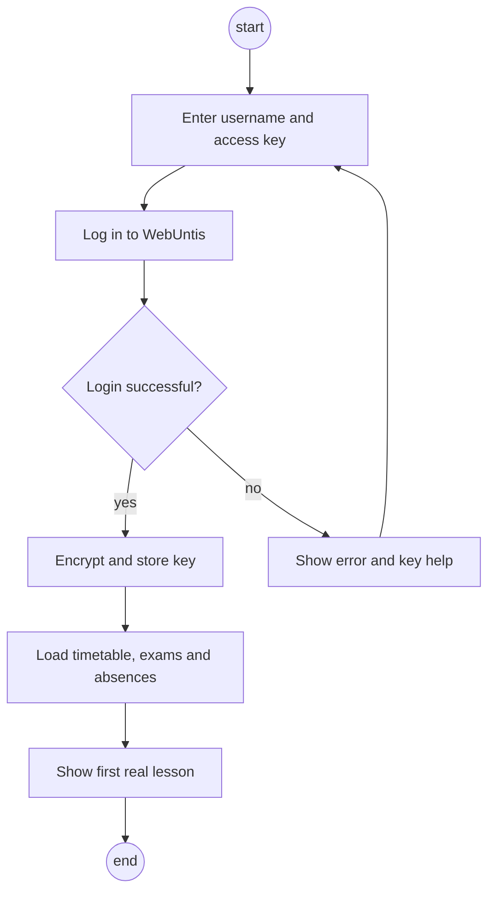

#### F02 · Plan the morning journey

| Characteristic | Description |
| --- | --- |
| Business process | BP1 Getting to school |
| Goal | The student knows when to leave home for the first real lesson. |
| Precondition | WebUntis is connected (F01). |
| Postcondition | A leave-by time exists for the next school day and is updated when lessons change. |
| Involved roles | Student; WebUntis |
| Triggering event | The student saves a route, or a timetable sync finds a changed first lesson. |

**Standard scenario.** The student picks home and school stops and walking times; LeoWay suggests a buffer (proposed: 5 minutes) and shows the leave-by time for the latest fitting connection.

**Non-standard scenario.** The first lesson is cancelled overnight: the next sync moves the leave-by time and the phone alarm (F04). If no connection fits, LeoWay shows the earliest possible arrival.

```screens
Call: Route and alerts
Home stop     Leonding Zentrum
School stop   Meixnerkreuzung
[Edit route]
---
Standard: leave-by time
First lesson  08:00
Bus 19        07:31 → 07:47
Leave by      07:24
---
Non-standard: lesson cancelled
First lesson  08:55  (08:00 cancelled)
Leave by      08:16  (was 07:24)
Alarm moved
```

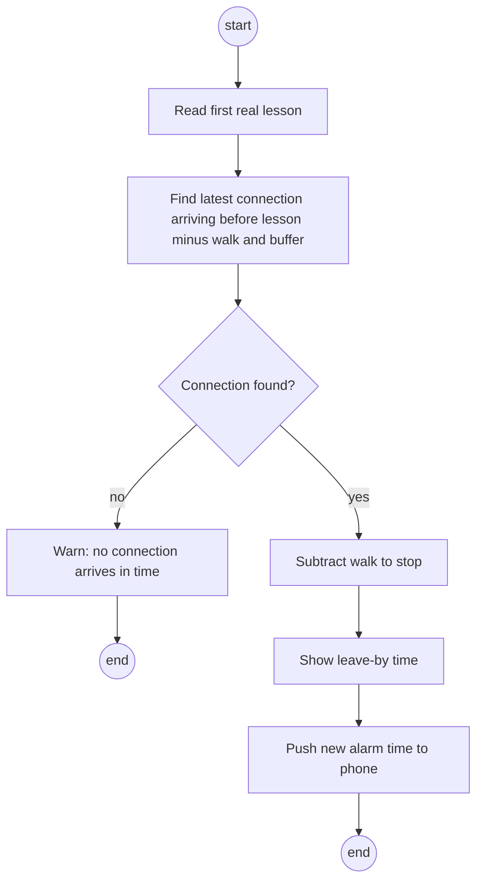

### 2.2 Block B: Alerts

LeoWay watches the student's connection and alerts them in the channels they chose.

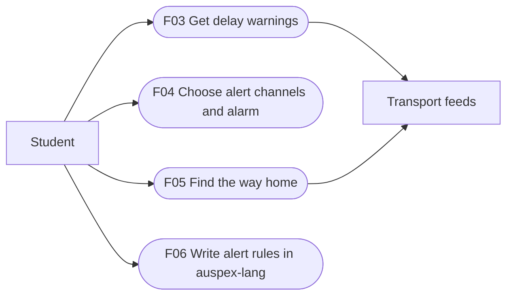

#### F03 · Get delay warnings

| Characteristic | Description |
| --- | --- |
| Business process | BP1 Getting to school |
| Goal | The student learns early that the saved journey will arrive late and gets an alternative. |
| Precondition | A leave-by time exists (F02); at least one alert channel is set (F04). |
| Postcondition | The student has received one warning per channel for the change; the alternative is shown on Home. |
| Involved roles | Student; transport feeds |
| Triggering event | A feed reports a delay or cancellation on the student's connection. |

**Standard scenario.** Bus 19 is +6 min, so the student would arrive 3 minutes late. LeoWay warns and suggests tram 3, adding an exam note if the first lesson is an exam.

**Non-standard scenario.** Without live data for the line, LeoWay shows "timetable only" and the last update time, and sends no delay warning.

```screens
Call: Home
Bus 19        +6 min
[View another connection]
---
Standard: warning
Warning: Bus 19 +6 min, arrive 08:03
Exam in first lesson
Take tram 3 at 07:29 instead
---
Non-standard: no live data
Bus 611       07:10
Timetable only
Last update   05:41
```

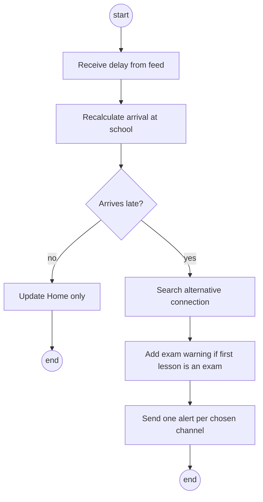

#### F04 · Choose alert channels and alarm

| Characteristic | Description |
| --- | --- |
| Business process | BP1 Getting to school |
| Goal | Alerts reach the student where they look; on Android, a leave-by alarm rings. |
| Precondition | The student is logged in. For the alarm: the Android app is installed. |
| Postcondition | Chosen channels are stored; the Android alarm is set for the current leave-by time. |
| Involved roles | Student; Discord, push service, email |
| Triggering event | The student opens "Route and alerts". |

**Standard scenario.** The student picks Discord and push and gets a test message on each. On Android, the alarm is set for the leave-by time and follows its changes. Channels are built in the order Discord, push, email.

**Non-standard scenario.** Android denies the exact-alarm permission. The app explains why it is needed and offers a normal high-priority notification instead.

```screens
Call: Route and alerts
Alerts        [Choose channels]
Alarm         off
---
Standard: channels set
[x] Discord  [x] Push  [ ] Email
Alarm         on · 07:24
Test message sent
---
Non-standard: no permission
Alarm needs "exact alarms"
[Open settings]
[Use notification instead]
```

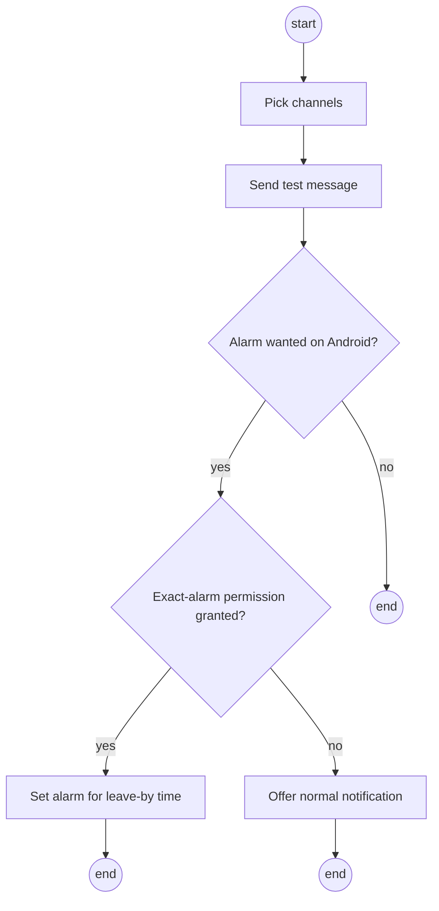

#### F05 · Find the way home

| Characteristic | Description |
| --- | --- |
| Business process | BP1 Getting to school (return trip) |
| Goal | The student sees the next connection home after the actual last lesson. |
| Precondition | WebUntis is connected and a route is saved. |
| Postcondition | Home shows the next journey home. |
| Involved roles | Student; WebUntis; transport feeds |
| Triggering event | The last lesson of the day ends, or a sync finds that lessons end early. |

**Standard scenario.** The last lesson ends at 15:25. LeoWay shows tram 3 at 15:34, allowing the walk to the stop.

**Non-standard scenario.** The last two lessons are cancelled. The next sync moves the journey home to the new end time, 13:45, and shows the next connection after it.

```screens
Call: Home (afternoon)
Way home      [Show]
---
Standard: way home
Last lesson   ends 15:25
Tram 3        15:34 → 15:52
---
Non-standard: early finish
Last lesson   ends 13:45 (changed)
Bus 19        13:51 → 14:06
```

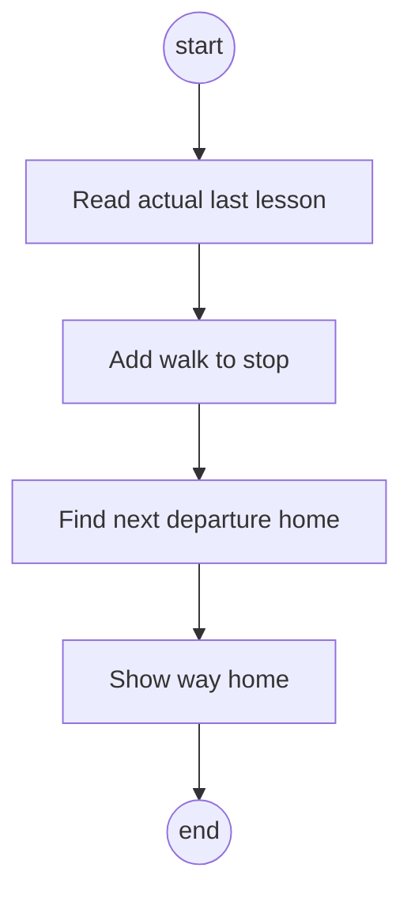

#### F06 · Write alert rules in auspex-lang

| Characteristic | Description |
| --- | --- |
| Business process | BP1 Getting to school |
| Goal | The student gets alerts only for situations that matter to them. |
| Precondition | WebUntis is connected; at least one channel is set (F04). |
| Postcondition | A valid rule is stored and checked with every delay update. |
| Involved roles | Student |
| Triggering event | The student opens "Alert rules". |

**Standard scenario.** The student writes `notify when delay > 5 min and first lesson is exam`. LeoWay checks the rule, reads exam days from WebUntis and alerts when both conditions are true.

**Non-standard scenario.** An invalid rule is rejected with the error position. If WebUntis has no exam data, exam days can be marked by hand.

```screens
Call: Route and alerts
Alert rules   [Edit rules]
---
Standard: rule saved
notify when delay > 5 min
  and first lesson is exam
Rule saved
---
Non-standard: invalid rule
notify when delay > five
                    ^
Error: expected a number of minutes
```

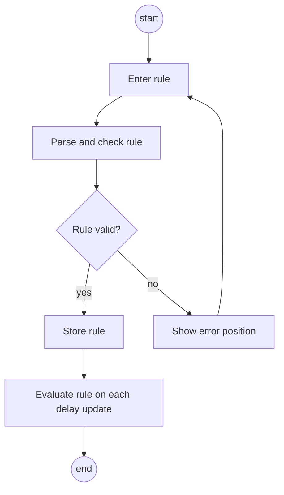

### 2.3 Block C: Delay appeals

LeoWay matches lateness entries with delay records; the form teacher checks the appeal by link or in the optional portal.


#### F07 · Prepare a delay appeal

| Characteristic | Description |
| --- | --- |
| Business process | BP2 Excusing lateness |
| Goal | The student sends a checkable appeal in under one minute; the form teacher can verify it. |
| Precondition | A lateness entry was synced from WebUntis; a delay record exists for the saved journey. |
| Postcondition | An appeal with a verification token exists; the email is opened in the student's mail app. |
| Involved roles | Student; form teacher; WebUntis |
| Triggering event | The noon or afternoon sync finds a new lateness entry. |

**Standard scenario.** LeoWay shows "You were marked 13 min late; your bus 19 was 11 min late." The student confirms, checks the editable email (line, stop, times, minutes late, verification link) and sends it. The form teacher opens the link and sees only the delay record.

**Non-standard scenario.** No record fits the window (proposed: 15 minutes) or the absence is longer than the first lesson: no appeal is suggested. Changed, expired or revoked links show "Link not valid".

```screens
Call: Home
[My lateness / draft appeal]
1 new lateness entry
---
Standard: suggested match
Late 13 min · 08:00–08:13
Bus 19 +11 min at Meixnerkreuzung
[Confirm and draft email]
---
Non-standard: no match
Late 25 min · 08:00–08:25
No recorded delay fits
this lateness entry
```

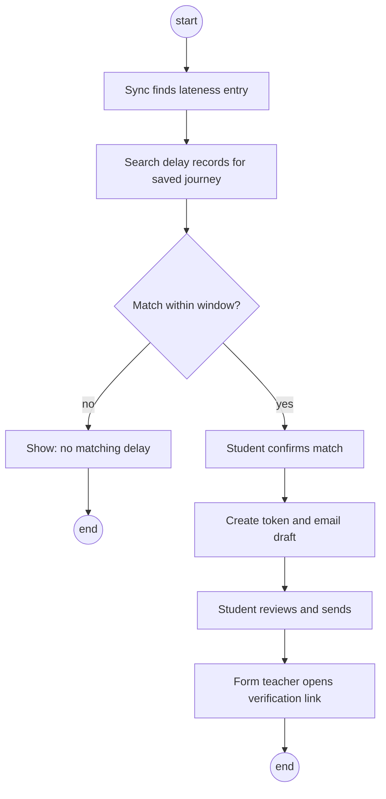

#### F08 · Handle appeals in the teacher portal (optional)

| Characteristic | Description |
| --- | --- |
| Business process | BP2 Excusing lateness |
| Goal | Enrolled form teachers handle appeals in one list instead of by email. |
| Precondition | The teacher is enrolled with a school-approved login and assigned to the class. |
| Postcondition | The appeal is marked approved or declined. The teacher still records the decision in WebUntis. |
| Involved roles | Form teacher |
| Triggering event | A student of the teacher's class sends an appeal. |

**Standard scenario.** The teacher opens the portal, sees the appeal with the line's reliability next to it and approves it.

**Non-standard scenario.** The teacher tries to open an appeal from another class. The portal denies access. Teachers who do not enrol keep receiving emails.

```screens
Call: Portal login
School login  [Sign in]
---
Standard: appeal list
3a · 08:13 · Bus 19 +11 min
Line on time 82%
[Approve]  [Decline]
---
Non-standard: other class
Access denied: not assigned
to this class
```

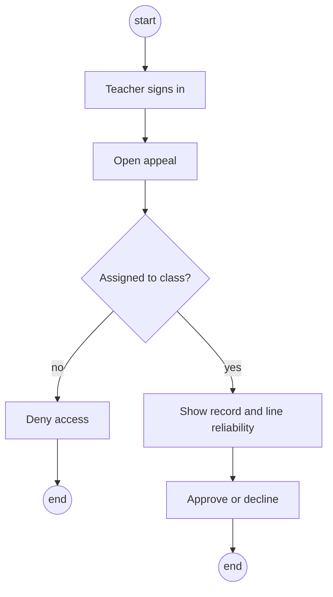

### 2.4 Block D: Delay data and community

Recorded delays feed warnings, appeals, prediction and statistics; students add crowd reports.

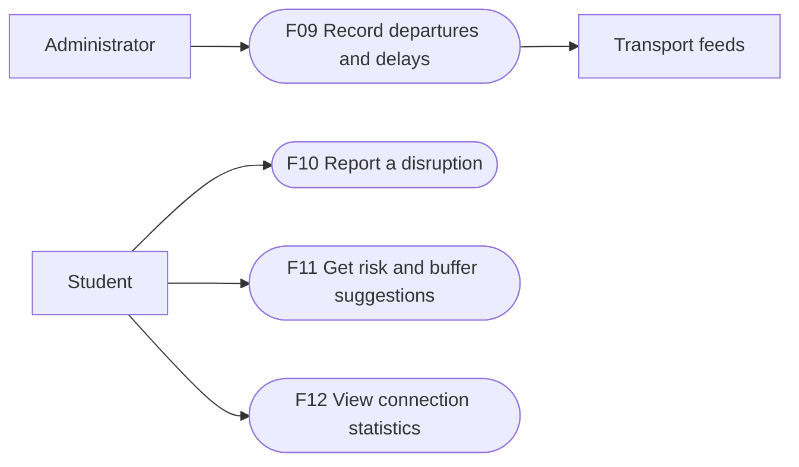

#### F09 · Record departures and delays

| Characteristic | Description |
| --- | --- |
| Business process | BP2 Excusing lateness, BP3 Reporting problem connections |
| Goal | A complete delay history with source and collection time. |
| Precondition | Feed adapters are configured. |
| Postcondition | New delay records are stored; the feed status shows the last update. |
| Involved roles | Administrator; transport feeds |
| Triggering event | The poll timer of a feed fires (also on holidays). |

**Standard scenario.** The recorder fetches Linz AG departures, stores each departure with line, stop, planned time, delay, source and collection time, and updates the feed status.

**Non-standard scenario.** A feed fails: other feeds keep running, the feed is marked stale after five minutes, the team is alerted and the recorder backs off.

```screens
Call: Admin · Feed health
[Open feed health]
---
Standard: all feeds running
Linz AG live   OK · 12 s ago
MVO timetable  OK · today 03:00
ÖBB timetable  OK · today 03:00
---
Non-standard: feed down
Linz AG live   STALE · 7 min
Retry in 2 min
Team alerted
```

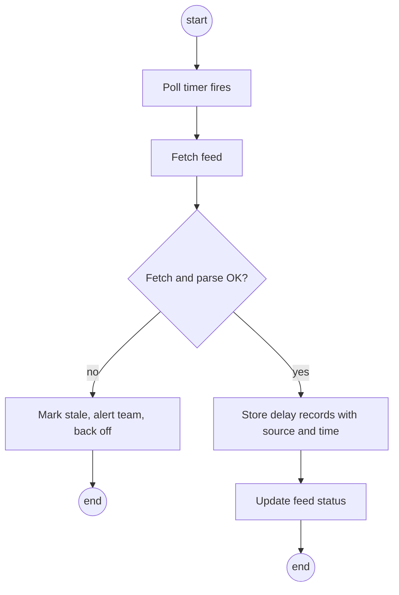

#### F10 · Report a disruption

| Characteristic | Description |
| --- | --- |
| Business process | BP1 Getting to school |
| Goal | Students warn each other before official feeds show a disruption. |
| Precondition | The student is logged in. |
| Postcondition | The report is stored; if the threshold is reached, a warning goes to students using that line. |
| Involved roles | Student |
| Triggering event | The student taps "Report disruption". |

**Standard scenario.** Three accounts report tram 3 at Meixnerkreuzung within ten minutes (proposed). LeoWay warns students on that line, marked as a crowd report.

**Non-standard scenario.** One student reports the same disruption several times. The reports count once and no warning is sent.

```screens
Call: Home
[Report disruption]
---
Standard: report sent
Line   Tram 3
Stop   Meixnerkreuzung
Reported · 2 others agree
---
Non-standard: repeated report
You already reported
this disruption
```


#### F11 · Get risk and buffer suggestions

| Characteristic | Description |
| --- | --- |
| Business process | BP1 Getting to school |
| Goal | The student sees how risky tomorrow's connection is and a personal buffer. |
| Precondition | Enough delay history exists for the connection (proposed: four weeks). |
| Postcondition | Home shows a risk level and a suggested buffer. |
| Involved roles | Student |
| Triggering event | The evening sync calculates the next day's journey. |

**Standard scenario.** LeoWay shows "Bus 19 on Mondays: high risk, leave 6 minutes earlier." The student can accept the buffer.

**Non-standard scenario.** The model is unavailable or worse than the baseline on recent data. LeoWay uses the stronger baseline and labels the suggestion as based on averages.

```screens
Call: Home (evening)
Tomorrow      [Show risk]
---
Standard: model suggestion
Bus 19 · Monday · high risk
Leave 6 min earlier
[Use buffer]
---
Non-standard: baseline only
Bus 19 · average +3 min
Based on averages
```

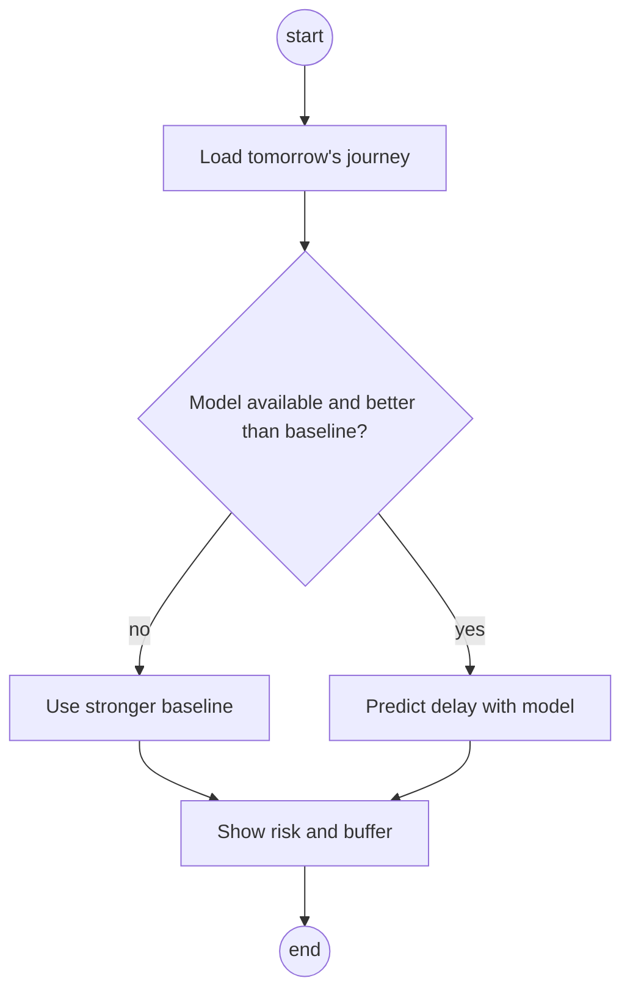

#### F12 · View connection statistics

| Characteristic | Description |
| --- | --- |
| Business process | BP3 Reporting problem connections |
| Goal | The student council gets evidence about connections that arrive after lessons start. |
| Precondition | Delay records exist for the chosen period. |
| Postcondition | A report is shown and can be exported; it names no students. |
| Involved roles | Student (student council member) |
| Triggering event | The user opens "Statistics". |

**Standard scenario.** The user picks the last school month. LeoWay lists connections ranked by how often they arrived after lessons started.

**Non-standard scenario.** A filter would leave fewer than five students behind a figure (proposed). LeoWay hides that figure so no student can be identified.

```screens
Call: Menu
[Statistics]
---
Standard: late connections
September 2026
Bus 19 07:31   late 34%
Tram 3 07:25   late 12%
---
Non-standard: too few users
Bus 618 07:02
Hidden: fewer than 5 users
```

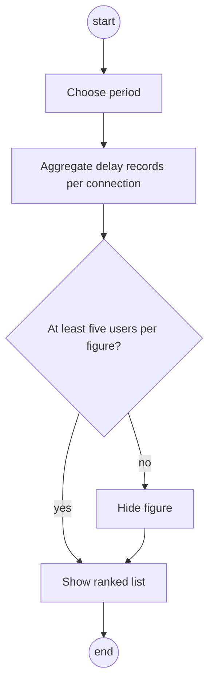

## 3. Non-functional requirements

Proposed targets on the agreed test server, checked in section 6.

### 3.1 Usability

Target group: students aged 14 to 19 checking their phone on the way to school, and form teachers who use email and WebUntis daily.

| ID | Requirement |
| --- | --- |
| U01 | The home screen works like the departure board at the stop: the first lesson, the leave-by time and the current delay of the student's own line are visible without scrolling on a 360 px wide phone screen. |
| U02 | Preparing an appeal from a suggested match takes at most three taps until the email draft opens. |
| U03 | Every time shown that comes from a prediction or a timetable (not live data) is labelled as such. |
| U04 | The email draft reads like a normal message from the student; the teacher needs no LeoWay account to check the link. |
| U05 | The website works with keyboard only and meets WCAG 2.1 AA contrast. |
| U06 | Proposed support: current Chrome, Firefox and Safari, and Android 10 or later for the Capacitor app. |

### 3.2 Efficiency

| ID | Requirement |
| --- | --- |
| E01 | Support 100 accounts and 20 active users at once. At least 95% of cached API requests finish within two seconds. |
| E02 | Evaluate a received delay within 60 seconds. Send only one alert per channel for the same change. |
| E03 | Live data older than five minutes is marked as stale. |
| E04 | Find a leave-by time or alternative connection within one second for a saved route. |

### 3.3 Maintainability

LeoWay runs over two school years and may later move to other schools or another team.

| ID | Requirement |
| --- | --- |
| M01 | Each feed sits behind one adapter interface. Adding a feed or changing one does not change the recorder or other adapters. |
| M02 | Alert channels share one notification interface; a new chat platform is added as one new implementation. |
| M03 | Adapter, timetable, matching and permission tests run in CI on every pull request. Code is reviewed before merge. |
| M04 | The repository contains setup and deployment steps, the API description (OpenAPI) and this specification. |

### 3.4 Security

| ID | Requirement |
| --- | --- |
| S01 | **Confidentiality:** HTTPS only. WebUntis keys are encrypted; the encryption key is kept outside the database and repository. Keys and private school data are never logged. |
| S02 | **Confidentiality:** the API checks record ownership on every private request. The administrator role has health and feed endpoints only. Database support access uses a separate, restricted account and is logged. |
| S03 | **Confidentiality:** verification links use random, unguessable tokens. Proposed: they expire after 30 days and can be revoked. They show only the delay record, source and collection time. |
| S04 | **Data integrity:** delay records cannot be changed after collection. Students can only confirm a match, not edit times. Invalid links cannot read or change records. |
| S05 | **Data integrity:** the WebUntis adapter calls only login/logout, timetable, timegrid, absence and exam endpoints. Messages, homework, grades and other data are blocked. |
| S06 | **Availability:** a failed feed does not stop other feeds. Proposed: the recorder reaches 99% uptime on school days between 05:00 and 10:00. Encrypted daily backups are kept for seven days, with a restore test before release. |

### 3.5 Legal constraints

| ID | Requirement |
| --- | --- |
| L01 | GDPR and the Austrian Data Protection Act apply. Use is voluntary; students aged 14 or older consent themselves. Privacy information is shown before connecting WebUntis. |
| L02 | Data minimisation: no GPS, no home address and no WebUntis password. Absence reasons and notes are never stored. Deleted accounts stay deleted after a restore. |
| L03 | Retention: routes and contacts until account deletion; timetable caches are replaced on sync; appeals and linked lateness entries until school-year end or account deletion. |
| L04 | The school (school IT) agrees to the use of student access keys and the sync frequency before real student data is used. |
| L05 | Data licences are respected: ÖBB timetables are CC BY 4.0 and credited in the app. VAO stays off until education access and limits are agreed; the stored Start contract allows only 100 queries per day per service. |
| L06 | LeoWay provides evidence only. Excusing lateness stays the form teacher's decision under school rules. |

## 4. Quantity structure

First estimates for 100 accounts (design limit 1,500), checked against measurements in the first sprints.

| Quantity | Estimate | Basis |
| --- | --- | --- |
| Student accounts | 100 planned, 1,500 design limit | Efficiency target E01 |
| Saved routes | 1–2 per student, up to 3,000 | Morning route and way home |
| Stops (master data) | about 10,000 | Imported from MVO and ÖBB GTFS; replaced on each import |
| Watched stops for live data | about 50 | Stops on saved routes plus the two school stops |
| Delay records per day | about 15,000 | 50 stops × about 300 departures per day |
| Delay record storage | about 0.2 KB each, about 1.1 GB per year | Including indexes; history is kept for prediction |
| WebUntis requests per day | about 3,000 at 100 accounts | About 30 sync calls per student per school day (section 5.2) |
| Lateness entries per day | up to 20 at 100 accounts | Assumption: a few students are late on a bad day |
| Appeals per day | up to 20 | At most one per lateness entry |
| Crowd reports per day | up to 50 | Mostly on disruption days |
| Alerts per day | up to 600 | 100 students × 2 alerts × up to 3 channels |
| Data per alert | under 2 KB | Short text message |
| Data per app start | under 50 KB | Home data without static files |

## 5. System architecture and interfaces

### 5.1 Components

Angular provides the website and teacher portal; Capacitor wraps it as the Android app. Quarkus runs the backend with PostgreSQL. Python trains the prediction model on the team's hardware. Each source has its own adapter; all channels share one alert ID to avoid duplicates.

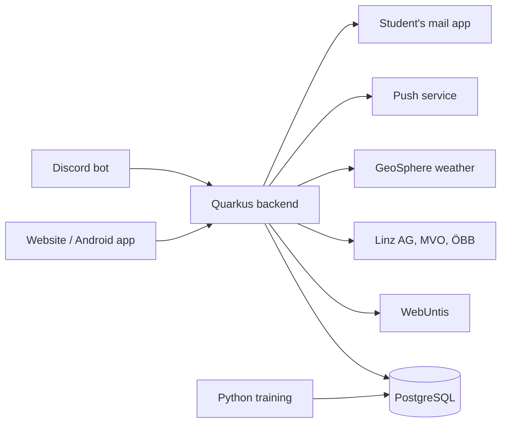

### 5.2 Interfaces

| Partner | Interface |
| --- | --- |
| Website and Android app | REST/JSON over HTTPS to the Quarkus backend; push data messages to the Android app for alarm changes. |
| WebUntis | JSON-RPC with the student's access key (webuntis package), read only. Allowed calls: login/logout, timetable, timegrid, absences and exams (getExamsForRange). |
| Linz AG Linien | Live departures and delays (GTFS-RT, EFA departure endpoint), polled by the recorder. |
| MVO, ÖBB | GTFS timetables, imported nightly. |
| VAO | Off until education access and limits are agreed. Without live data, show "timetable only". |
| GeoSphere Austria | Weather data as input for prediction. |
| Discord, push, email | One notification interface; each channel is one implementation. Appeals open as a mailto draft in the student's own mail app. |
| Form teacher | Verification link in the browser; optional portal with school-approved login. |

**WebUntis sync (proposed, Europe/Vienna):** lessons and exams at 20:00 for the next day, at 05:00 and every 15 minutes from 05:00 to 10:00; absences at 12:00 and 16:00. Students can refresh manually. Data is cached and requests back off after errors; limits are confirmed with school IT.

**Alarm updates:** after a lesson change, the backend pushes the new alarm time with a version to the phone. The app cancels the old alarm and sets the new one, and ignores older versions. It syncs again when opened. If updates cannot arrive, it shows the last sync time; alarm changes are not guaranteed while offline or force-stopped.

### 5.3 Domain model

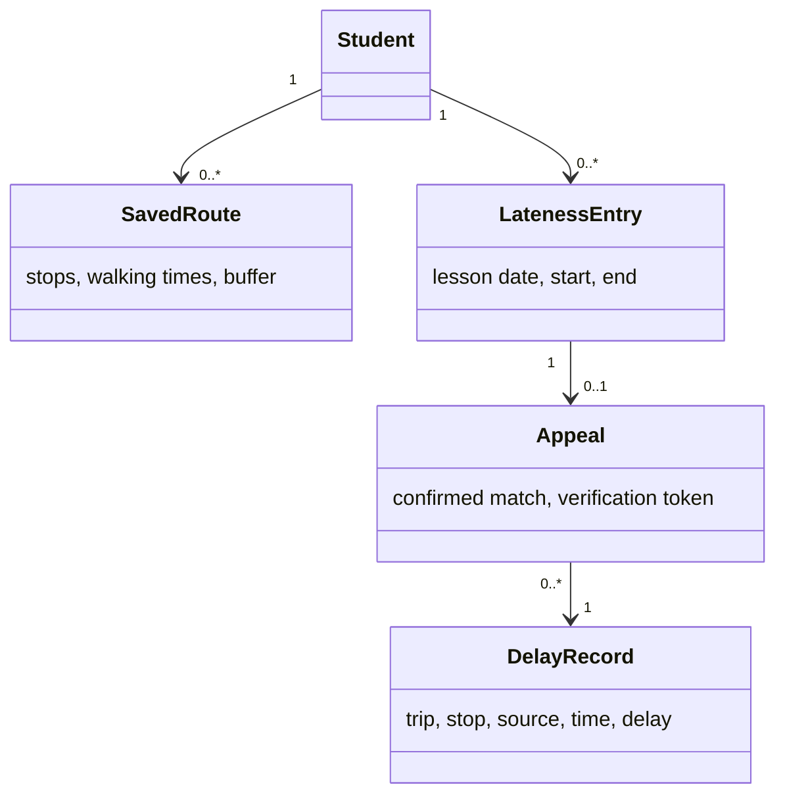

### 5.4 Calculation and time rules

Choose a journey that arrives before the first lesson, allowing the school walk and buffer. Subtract the walk to the stop from the departure time. If none fits, show a warning.

Keep the trip's service date. Store timestamps in UTC and display Europe/Vienna time. Mark predicted times as predictions. Proposed: suggest a match if the saved journey's school arrival is within 15 minutes of the end of the lateness entry. The student confirms every match.

## 6. Acceptance criteria

Tests follow the standard and non-standard scenarios in section 2. The teacher and team agree which features are delivered; each passes on its own. Private records use test data.

| Test | Pass condition |
| --- | --- |
| A01 · F01, S05 | Standard: connect with a valid key; an exam is found without manual marking; the noon or afternoon sync finds a new lateness entry. Non-standard: a wrong key is rejected and nothing is stored; forbidden data calls are blocked. |
| A02 · F02 | Standard: a leave-by time is shown for a saved route. Non-standard: cancel the first lesson overnight and in the morning; the leave-by time and phone alarm move. Ignore an older push; check offline recovery and a daylight-saving change. |
| A03 · F03 | Standard: a delay that causes late arrival shows a warning and an alternative, plus the exam warning when needed. Non-standard: without live data, "timetable only" is shown. |
| A04 · F04, E02 | Standard: one message per chosen channel within 60 seconds; the alarm rings on a real Android phone. Non-standard: with permission denied, a normal notification is offered. |
| A05 · F05 | Standard: the way home follows the last lesson. Non-standard: end lessons early; the next connection after the new end time is shown. |
| A06 · F06 | Standard: a delay/exam rule fires using a WebUntis exam. Non-standard: an invalid rule shows an error; manual marking works when exam data is missing. |
| A07 · F07, U02 | Standard: three students each prepare the correct draft in under one minute; its link shows the chosen record. Non-standard: no match is suggested outside the window or for longer absences; changed, expired and revoked tokens are rejected. |
| A08 · F08 | If built: standard, a teacher handles an assigned appeal; non-standard, the teacher cannot open another class. |
| A09 · F09, E03, S06 | Standard: records keep source and time. Non-standard: disconnect a feed; old data is marked stale and other feeds keep working. |
| A10 · F10 | Standard: three accounts trigger a warning. Non-standard: repeated reports from one account count once. |
| A11 · F11 | Test on later dates excluded from training. Compare mean delay error with both baselines. Non-standard: keep the stronger baseline if the model loses. |
| A12 · F12 | Standard: a known late connection appears in the statistics. Non-standard: figures with fewer than five users are hidden. |
| A13 · S01–S04, L02 | Student A cannot read B's records. An administrator cannot use private endpoints. Deletion removes private data and survives a backup restore. |
| A14 · E01, E04, U01, U05, U06, M03 | Meet the load targets, phone-width and keyboard checks in the supported browsers, a test of the Android app on a real phone, and CI checks; record the results. |

### 6.1 Delivery and open decisions

Deliver code, database changes, tests, deployment steps, a short user guide and test results. Work in two-week sprints. Update the backlog and this document when requirements change.

Confirm the final name, product owner, hosting, WebUntis permission and limits, VAO access, the teacher email source and the optional teacher login. Until email lookup is agreed, the student enters and checks the address. Review proposed settings with the teacher before release.
